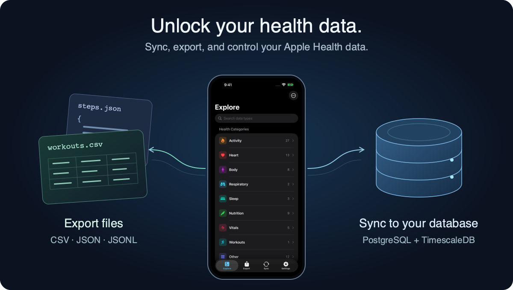
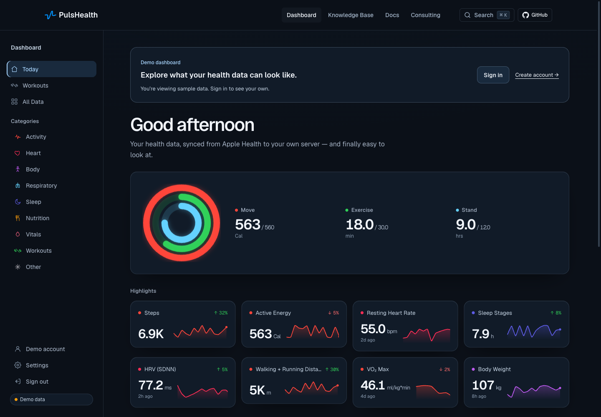
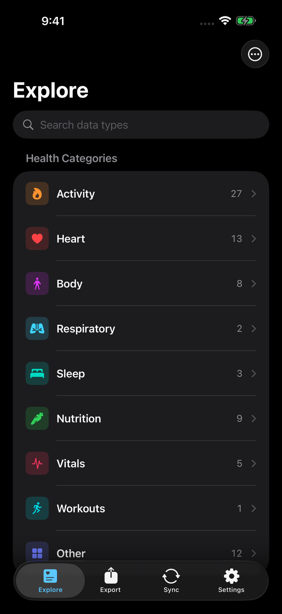
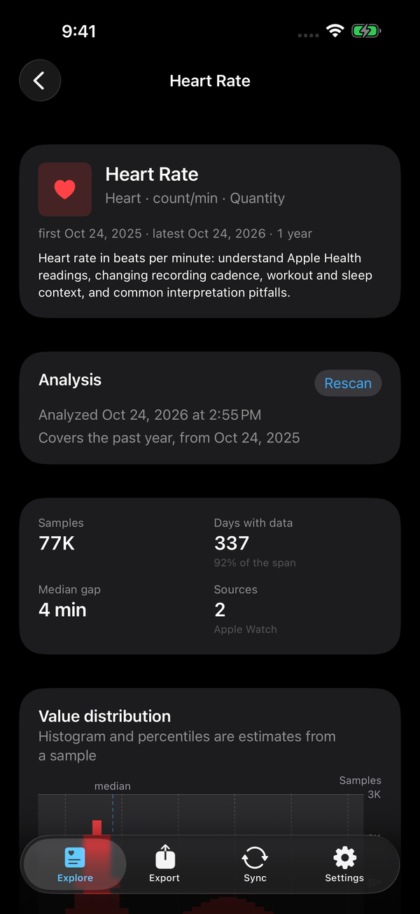
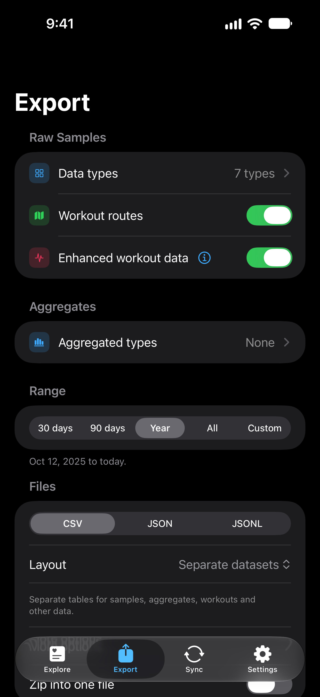

# PulsHealth

**Sync and export your Apple Health data.**

Export files from your iPhone or iPad, or keep your health history in a database
you control. PulsHealth includes the app, a self-hosted stack, and an open sync
protocol. Everything in this repository is [Apache-2.0](LICENSE).

**[Get the iOS app](https://apps.apple.com/us/app/pulshealth/id6757657354)** ·
**[Self-host it](docs/setup.md)** · **[Read the docs](https://pulshealth.com/docs/)**

  

## Make something with your data

Explore [cool examples](https://pulshealth.com/cool-examples/): a health year
in review, marathon training, activity as art, and an atlas of walks, runs and
rides. Explore recorded examples, then use your own files with the
[local adapter and instructions](examples/showcase/README.md).

## Get started

- **Export files:** install the app, grant Health access, and choose the types,
  dates, and format in Export. [Export guide](docs/export.md#on-device-export-no-server).
- **Sync to your database:** run the Docker stack and pair your phone. It
  includes PostgreSQL + TimescaleDB, a web dashboard, Grafana, and APIs.
  [Setup guide](docs/setup.md).

The app reads Apple Health without modifying it. Background sync depends on
iOS, Health access, and Watch-to-phone delivery. The self-hosted backend is
**pre-release (0.x)**; see the setup guide for networking and backups.

## See the dashboard

Explore activity, sleep, heart rate, and workouts in your browser.
[Try the interactive demo](https://app.pulshealth.com/demo) with sample data.

  

## See the app

  
  
  

*App captures use synthetic data. [Image provenance](docs/images/README.md).*

## Build with your data

| Use case | Guide |
|---|---|
| Query your database | [Schema and query patterns](docs/database-guide.md) |
| Build an app or integration | [Product API](docs/api.md) |
| Connect an AI assistant | [Read-only MCP tools](docs/ai.md) |
| Automate your home | [Home Assistant integration](https://github.com/PulsHealth/home-assistant) |
| Write your own receiver | [Sync protocol](docs/protocol/README.md) · [Python + SQLite example](examples/receivers/python-sqlite/README.md) |

AI tools share the records they read with your chosen AI provider.

## Documentation and development

- [App](PulsHealth/README.md) · [Swift sync library](PulsHealthSync/README.md)
- [Server](server/README.md) · [Web dashboard](web/README.md)
- [HealthKit type reference](https://pulshealth.com/knowledge-base/)
- [Sync troubleshooting](https://pulshealth.com/blog/apple-health-not-syncing/)
- [Contributing and tests](CONTRIBUTING.md) · [Roadmap](docs/roadmap.md)
- [Security](SECURITY.md) · [Privacy](docs/privacy-policy.md) · [License](LICENSE) · [Trademarks](TRADEMARK.md)
