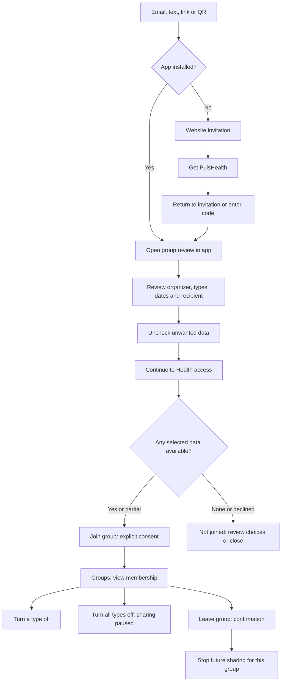
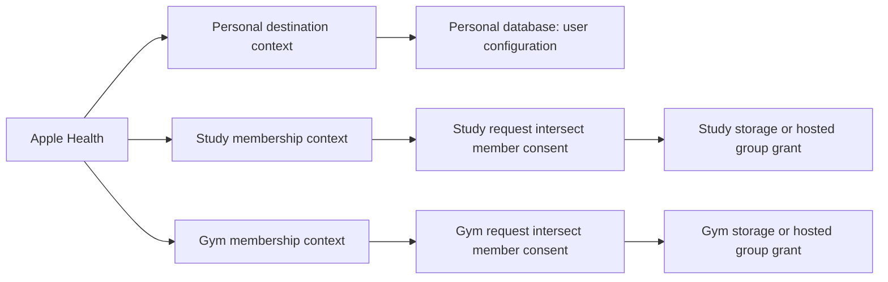
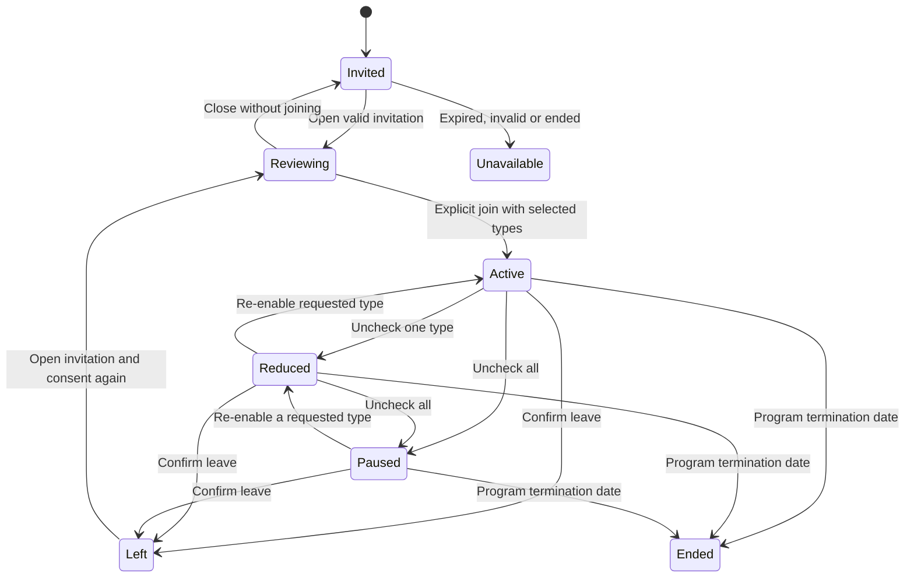
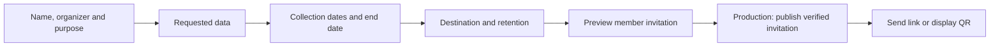

# Groups UI preview

Tracks [#445](https://github.com/PulsHealth/pulshealth/issues/445). This is a
branch-only experience prototype for studies, gyms, programs and classes. It is
not an enrollment service. Do not merge or deploy it as a working data-sharing
feature.

## Try it

Website: `cd site && bun install --frozen-lockfile && bun run dev --port 3147`,
then open `http://localhost:3147/groups/preview/`. The page is noindex and is
deliberately absent from public navigation, search and the sitemap.

The four views cover the website invitation, member app, organizer setup and
experience map. Choose a sample, toggle whether the app is installed, and try
expired/invalid/ended invitations. The organizer form creates an in-memory
invitation draft that you can join in the browser preview. Custom drafts cannot
be published or opened in the native app. Copyable links resolve only the three
fixed synthetic examples.

Native app: open the generated PulsHealth Xcode project in this task checkout,
run **Debug**, and go to **Sync → Groups preview**. Try invitations there, or
open `puls://group-preview?code=move-together`. Codes `sleep-study` and `gym`
exercise a separate recipient and an ongoing program. The website's QR codes
encode these same Debug-only links; scan them with iPhone Camera. On a fresh
install, opening one presents the group review over onboarding. Closing the
preview returns to the normal required first-run flow; the preview never marks
that flow complete or bypasses its Health step.

Both previews keep synthetic membership choices in memory. Reloading the page
or ending the app process clears them. No group credentials, health queries,
upload engines, accounts, group analytics events, consent records or server grants
are created. Release builds exclude all native group code and entry points.
The App Store build does not understand the preview links.

## The member experience

One invitation review shows the organizer, purpose, requested types, data dates,
sharing end, recipient and retention. The primary action continues to the
Health-access step; a final **Join group** confirms the selected sharing.
Organizer requests define the maximum scope, while members can reduce it. A
member cannot add types or widen dates. Opting out may affect participation,
but never disables the opt-out control.

HealthKit does not reveal whether read access was granted. The simulated Health
step is a test control, not a suggested production permission detector. Real
membership and consent must be distinct from data availability; display “No
readable data yet” rather than claiming permission was granted or denied.

First-time joining should offer focused group context instead of the generic
product tour, while retaining a neutral, mandatory Health pre-permission step.
That replacement is visualized in the browser; the native Debug preview opens
over the existing onboarding and does not change the shipped onboarding policy.

## Keep destinations separate

The minimum navigation change is a **Groups** row in Sync. Personal databases
remain user-configured. Group details expose consent, not endpoint/token/type
editors. Every membership has an independent policy and lifecycle, even when
two groups happen to share a host.

Leaving and unchecking are distinct from deletion. Stop future sharing and
revoke hosted access; data already exported to a recipient may remain under its
disclosed retention policy. Never promise that leaving deletes those copies.
Previously enabled types must not silently resume on a later rejoin.

## Organizer experience

The browser form implements through **Preview member invitation**. Publishing,
email/text delivery, a manager roster and manager data access are not connected.
The website does not send messages or create real groups.

## Hosting decision

The UI works with either model; the recipient and retention remain visible.

| Model | Implementation boundary | Tradeoff |
| --- | --- | --- |
| Hosted group grant | Membership binds authenticated member identity, group, exact types, date bounds and policy version. Every manager read applies that grant. | One copy of data, immediate server-side access revocation, stronger central responsibility for isolation. |
| Separate group database | A membership gets its own destination-scoped identity, Keychain credentials, engine/store and bounded sync policy. | Storage separation, independent failures and uploads; the recipient controls previously delivered copies. |

Start production with one model after testing the flow. Do not fan out the
existing personal engine by mutating its active destination per upload. The
current app supports saved personal database configurations, but this preview
does not turn them into simultaneous background group pipelines.

## Production contract still required

- Resolve an opaque, scoped invitation from a trusted service. Validate
  signature/session, expiry, revocation, group status and policy version. A
  custom URL scheme authenticates nobody. The prototype accepts only three
  fixed fixtures and never trusts an endpoint embedded in a link.
- Configure Universal Links and the domain association. Installation does not
  automatically preserve arbitrary link context: retain a return-to-invitation
  path and short code. Do not claim deferred deep linking works because a
  website button opens the App Store. No Universal Link association is added
  on this branch.
- Keep member identity separate from group-manager identity and personal
  pairing credentials. Never use a group link as permission to read another
  user. A manager cannot widen a policy without a new member consent version.
- Record consent version, requested scope, chosen subset, bounds, recipient,
  join/revoke timestamps and retention disclosure. Server records use epoch
  milliseconds; the preview's date strings are presentation fixtures only.
- Enforce effective scope as request ∩ member consent ∩ readable HealthKit
  data, bounded by the requested start/end and current membership. HealthKit
  permission is app-wide; membership consent is per group.
- Revocation stops new jobs, cancels in-flight work at safe boundaries and
  removes recipient access on the server. Enforce membership expiry on every
  read/upload rather than relying on a phone timer. Define failure behavior
  for offline opt-outs and label unconfirmed server revocation honestly.
- For multiple receiving databases, anchors, watermarks, logs, credentials,
  retries and errors must be destination/membership-scoped. Preserve
  anchor-after-ack and isolated export invariants. Never attach a group
  upload to the personal engine's anchors.
- Decide whether programs sponsor app access. The preview bypasses no existing
  subscription policy and does not establish program pricing or entitlements.
- Update privacy disclosures, Health permission copy, App Store answers and
  recipient agreements alongside real storage/network behavior. The sample
  organizers and retention periods here are fictional UI content.

## Acceptance walkthrough

1. Open each sample link; verify requested types, dates and recipient.
2. Turn one type off before joining; it stays off on group details.
3. Simulate partial Health access; only the simulated available subset joins.
4. Simulate decline; no membership is created. Close without joining too.
5. Join two groups; turn all sharing off for one; the other stays unchanged.
6. Cancel leaving, then confirm leaving; only that membership disappears.
7. Reopen an existing invitation; no duplicate membership or expanded consent.
8. Try expired, invalid and ended invitations; none can join through that
   invitation. Native fixtures cover valid/unknown links; browser controls
   cover invitation lifecycle states, without claiming server enforcement.
9. Try “App installed” off; install instructions preserve the return/code path.
10. Draft a custom organizer request and try it as a member. Reverse dates,
    missing recipient host and empty type selections cannot produce a preview.

Automated coverage includes fixture-only native link parsing, duplicate joins,
scoped opt-out/leave, no consent expansion and organizer draft validation. The
browser walkthrough also checks phone-width layout and keyboard-focusable
controls. Actual enrollment, revoked server access, background multi-destination
sync and post-install routing require production integration and device tests.
