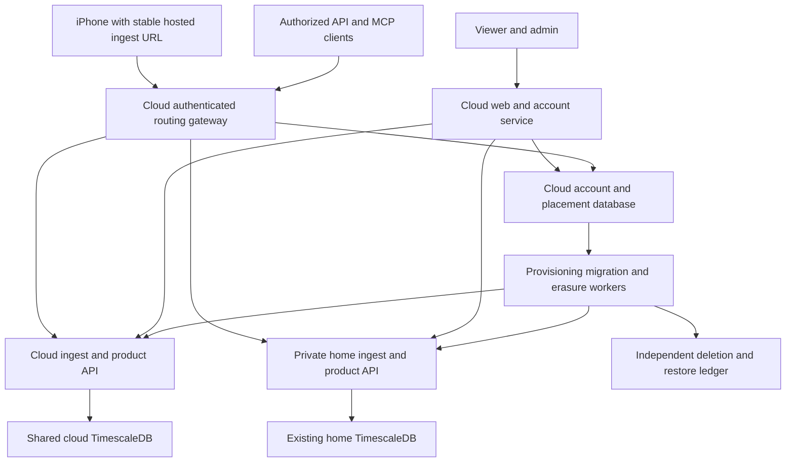

# Production hosting and user storage placement

Research and design dated October 12, 2026. Status: proposal; no infrastructure provisioned, data moved, or runtime code changed. Repository baseline: `6dba04f`.

## Recommended direction

Keep the current Timescale backend as the compatibility baseline while benchmarking the ordinary-PostgreSQL and 30/90-day archive alternatives added on October 13 below. For an existing-engine managed move, evaluate **Tiger Cloud on AWS** first for managed operations, and **self-managed TimescaleDB on AWS EC2** as the lower infrastructure-cost alternative. The product currently uses Timescale-specific capabilities; RDS and Aurora cannot run its schema unchanged.

Introduce a cloud **control plane** for accounts, login, admin, device credentials and placement, with separate **data cells** for health records. New users default to a shared cloud cell. The two existing operator accounts remain pinned to the home cell. This matches the requested boundary: health records can be stored in different places; everything else can share cloud infrastructure. Health payloads may pass through cloud services under this design; home storage is not a promise that cloud services never process the payload.

Build placement of compatible databases first. Different regions, dedicated customer instances, private networks and customer-operated databases fit this model. Supporting arbitrary database engines is a separate product investment.

The cheapest server and the best operational choice need not be the same. Compare the invoice, acknowledged-write durability, recovery time, engineering effort and ongoing on-call burden together. Thousands of accounts alone do not establish required capacity: history depth, raw measurements, GPS, aggregate granularity and onboarding rate determine much of the cost.

## What the current product requires

The Compose database image is PostgreSQL 17.11 with TimescaleDB 2.29.2. The schema uses hypertables, columnstore compression, continuous aggregates, background jobs and Timescale-aware deletion. These are functional dependencies, not optional optimizations. See [Compose](../server/docker-compose.yml), [base schema](../server/db/migrations/001_schema.sql), [workout series](../server/db/migrations/006_workout_enhanced.sql), [rollups](../server/db/migrations/008_quantity_rollups.sql) and [account deletion](../server/db/migrations/027_account_deletion.sql).

[web/lib/db.ts](../web/lib/db.ts) has one application pool plus a reserved health-check pool pointing at one database. Accounts and health reads share that destination. Ingest and product API also initialize one database-backed store. Approval, pairing, credential revocation and account deletion depend on SQL functions joining account and health schemas in one transaction.

Consequently, an admin field containing a per-user connection string would not implement this feature safely. The transaction boundaries and identity authority must change as well.

### Provider shortlist

**Tiger Cloud:** closest managed fit for existing health storage. Retains Timescale capabilities and supplies managed recovery and replication. Tradeoffs include a substantially higher hot-storage price than raw block storage, restricted administrative privileges, provider-specific features and plan-dependent contracts. Exact managed compatibility must be demonstrated on a disposable service before selection.

**AWS EC2 with TimescaleDB:** preserves the engine and gives full control over versions, roles and storage. EC2 is managed virtual infrastructure, not a managed database: PulsHealth owns replication, fencing, WAL archiving, PITR, security patches, upgrades and recovery. A durable HA design needs multiple hosts across failure domains, failover coordination and tested write fencing. Keeping a Docker container alive does not supply those properties.

**AWS RDS or Aurora PostgreSQL:** strong candidates for the central account database or a future ordinary-Postgres health backend. TimescaleDB is absent from the current supported extension catalogs. Replacing it requires native partitions, replacement rollup/compression/job mechanisms, rewritten purge handling and new capacity tests. RDS Trusted Language Extensions do not make the existing Timescale extension installable. [RDS catalog](https://docs.aws.amazon.com/AmazonRDS/latest/PostgreSQLReleaseNotes/postgresql-extensions.html), [Aurora catalog](https://docs.aws.amazon.com/AmazonRDS/latest/AuroraPostgreSQLReleaseNotes/AuroraPostgreSQL.Extensions.html).

**Aiven and Crunchy Bridge:** their Timescale offerings use the Apache-only edition, which does not provide the full feature set used here. They are not drop-in hosts for the current schema. [Aiven documentation source](https://github.com/aiven/aiven-docs/blob/main/docs/products/postgresql/concepts/timescaledb.md), [Crunchy extensions](https://docs.crunchybridge.com/extensions-and-languages).

**DigitalOcean, Lightsail or a low-cost VPS with self-managed TimescaleDB:** useful for a pilot or for an operator deliberately accepting single-node availability. They can run the full engine when installed by the operator. Cheap shared CPU, a single disk and daily snapshots are not equivalent to HA or zero acknowledged-write loss. As a price anchor, DigitalOcean lists an 8 GiB, 4 vCPU, 160 GiB shared-CPU plan at $48/month; that is one VM, not the whole service or evidence of capacity. [Droplet pricing](https://www.digitalocean.com/pricing/droplets), [Lightsail pricing](https://aws.amazon.com/lightsail/pricing/).

Keep the marketing static site independent. Initially use familiar container images for the application, rather than introducing Kubernetes or a new database model to solve this problem. ECS/Fargate offers managed app scheduling; one or two application VMs cost less but leave more host maintenance to the operator.

## Durability and availability are separate decisions

PulsHealth advances its HealthKit anchor only after a successful upload acknowledgement. If the database subsequently loses that acknowledged write, ordinary incremental syncing might never resend it. A database that automatically fails over can therefore still violate the product's data guarantee.

Tiger's economical one-standby configuration is asynchronous. Its high-data-integrity configuration uses a synchronous and an asynchronous replica alongside the primary. The documented configurations cost approximately two or three copies respectively. Synchronous replication adds write latency. Validate durable WAL acknowledgement, failover selection and behavior when the synchronous standby is unavailable; do not describe any configuration as protecting against every possible loss. [Tiger HA](https://www.tigerdata.com/docs/deploy/tiger-cloud/tiger-cloud-aws/high-availability/high-availability), [replication semantics](https://www.tigerdata.com/blog/scalable-postgresql-high-availability-read-scalability-streaming-replication-fb95023e2af).

Proposed default production requirement: **no loss of acknowledged uploads under a single primary or availability-zone failure**. If a cheaper asynchronous deployment is chosen, an independently durable batch journal and tested replay mechanism would be required to offer that same guarantee. A recent-data overlap alone would not reliably recover old backfill, historical updates or tombstones. Never acknowledge an in-memory queue.

Start with primary reads to avoid replica-lag surprises after ingest or credential changes. Add read replicas only when measured contention justifies their cost. Provider failover time is one component of recovery: application reconnection, routing and authorization also have to work.

Suggested initial service objectives, to validate rather than advertise immediately:

- Cloud authenticated reads and writes: 99.9% monthly availability, measured end to end.
- Acknowledged writes: zero-loss target for the defined single-node/AZ failure class.
- In-region failover: service recovers within five minutes in a drill.
- Full database recovery: initial four-hour target, replaced by a measured value as data grows.
- Region loss: separately declared recovery point/time; in-region HA does not cover it.
- Home cell: an explicit personal-service availability class. Its outage affects its assigned users, not the cloud population.

Tiger's legal Enterprise SLA specifies 99.9% for HA-replicated services and 99.8% otherwise, with exclusions; non-Enterprise credits are discretionary. An infrastructure SLA is not PulsHealth's end-to-end SLA. [Service-level agreement](https://www.tigerdata.com/legal/service-level-agreement).

## Cost from cheapest to more resilient

All amounts below are USD monthly planning ranges, excluding tax, engineering/on-call labor and negotiated compliance or production-support contracts. Pilot figures assume a small population and little history; they are not promises for 1,000 users.

1. **Existing home server:** lowest additional invoice. Hardware, electricity, maintenance and backup remain costs. Unsuitable as the default public-service failure domain; retain it for the pinned personal accounts.
2. **Single cloud VM with self-managed TimescaleDB:** approximately **$75–250** for a small pilot, allowing for application hosting, modest storage and off-host backups. Lowest cash route. Single-node interruption and recovery gaps remain; daily dumps alone may lose acknowledged uploads after a disaster. Scaling to dense multi-year history changes the bill and machine requirements.
3. **Managed single-node Timescale plus app hosting:** approximately **$150–600** for a small pilot, conditional on a quote and small storage footprint. Less DBA work, still not automatic HA or a single-failure zero-loss guarantee.
4. **Self-managed multi-host production on AWS:** illustrative **$700–2,000 at 1,000 base-profile users**, with three database copies and application/control services. Lower storage invoice than managed Timescale, higher implementation and ongoing operating work. This range uses instance-compute allowances, not a selected EC2 SKU or validated sizing; WAL, snapshots, inter-AZ traffic and incident time can push it higher.
5. **Managed durable HA plus cloud app/control services:** approximately **$1,100–2,300 at 1,000 lean-profile users**, or **$2,500–3,700 at 1,000 base-profile users with three years of history**. Easier routine operations; history and replicated hot-storage charges dominate as the population grows.
6. **Enterprise/residency/dedicated deployments:** quote individually. Separate customer capacity, private connectivity, cross-region recovery, production support and contractual requirements add costs. A dedicated database should have a minimum subscription or infrastructure pass-through price.

These options are not a ranked reliability ladder: a well-operated self-managed system can be durable, while a poorly configured managed one can be unsafe. Compare actual tested behavior.

### Billing model and quote requirements

Tiger advertises compute starting at $30/month Performance and $36/month Scale. Its $0.177/$0.212 storage figures are **effective prices assuming fivefold compression**, not safe rates to apply again to already-compressed bytes. This proposal uses **$1.06 per physical hot GB-month as a provisional Scale assumption**, derived as $0.212 × 5. Confirm the billed physical rate in a configured quote. Each HA replica adds compute and hot-storage charges. [Pricing](https://www.tigerdata.com/pricing).

Model:

```text
managed monthly cost =
  database copies × (primary monthly compute + hot physical GB × hot rate)
  + shared cold original-uncompressed database GB × cold rate
  + private networking/pooling/support add-ons
  + app compute + control database + load balancing/networking
  + logs/metrics + email + export storage + independent recovery costs
```

Tiger's billing documentation distinguishes consumed high-performance storage from **original uncompressed bytes** in tiered storage. Normal database ingest/egress, queries and automated backups have no separate Tiger charge; application-provider transfer and network costs still apply. Private networking and other add-ons require checking. [Billing documentation](https://www.tigerdata.com/docs/deploy/tiger-cloud/tiger-cloud-aws/pricing-and-account-management).

For AWS self-management, price provisioned EBS storage, not just bytes occupied by records. Add headroom for WAL, recompression, maintenance, restores and future growth. AWS's gp3 example rate is $0.08/GB-month: 517 GB × three copies × $0.08 is approximately **$124/month for that allocated disk amount**, compared with approximately $1,644 at the provisional managed physical rate. Neither amount includes compute or adequate free-space headroom. This shows the economic tradeoff; it does not make either system production-ready. [EBS volume pricing example](https://aws.amazon.com/ebs/volume-types/).

AWS application costs have a fixed floor. In US East on-demand Linux/x86 examples, a 1 vCPU/2 GB Fargate task is about $36/month at 730 hours; six such tasks are about $216. ALB adds roughly $16/month plus usage. Two AZ NAT gateways add roughly $66/month before per-GB processing and addresses. These are reference calculations, not selected machine sizes. Include central database, workers, logs, secrets, SES, image storage and internet exports. Co-locate application and managed data cell in one region. [Fargate](https://aws.amazon.com/fargate/pricing/), [load balancer](https://aws.amazon.com/elasticloadbalancing/pricing/), [VPC](https://aws.amazon.com/vpc/pricing/), [CloudWatch](https://aws.amazon.com/cloudwatch/pricing/), [S3](https://aws.amazon.com/s3/pricing/).

Avoid duplicate charges in estimates: DB-provider networking, AWS internet egress, NAT processing, inter-AZ traffic and private endpoints are different line items. An S3 gateway endpoint can avoid NAT processing for that path; interface endpoints have their own charges.

## Capacity assumptions and economics

These are synthetic scenarios, not observed usage. Decimal GB, 365 days/year. The model estimates the current schema, with a 60-day effective row-store window, because monthly chunks compressed after 30 days can retain more than 30 days of uncompressed data.

Per user/day:

- **Lean:** 500 numeric points, 100 GPS points, 40 occupied hourly type/source buckets, 10 phone aggregate buckets.
- **Base:** 3,000 numeric points, 500 GPS points, 480 occupied hourly type/source buckets, 40 daily phone aggregate buckets.
- **Heavy:** 20,000 numeric points, 3,000 GPS points, 1,920 occupied hourly type/source buckets, 960 hourly phone aggregate buckets.

Assume numeric rows cost 300 bytes hot and 60 bytes compressed, with a 30% allowance; GPS and rollup rows 160 bytes each; phone aggregates 200 bytes each; another 5% for miscellaneous data. These allowances require measured replacement. They do not adequately bound unusually large ECG, heartbeat, medication or metadata payloads.

```text
physical GB per user = 1.05 × [
  1.30 × numeric_points_per_day ×
    (min(history_days,60) × 300 + max(history_days−60,0) × 60)
  + GPS_points_per_day × history_days × 160
  + occupied_hourly_rollups_per_day × history_days × 160
  + phone_aggregate_buckets_per_day × history_days × 200
] / 1,000,000,000
```

At three years, that is approximately **0.083 GB lean, 0.517 GB base, 3.313 GB heavy per user per copy**. At 1,000 users: 83 GB / 517 GB / 3.31 TB; at 5,000: 414 GB / 2.59 TB / 16.56 TB; at 10,000: 827 GB / 5.17 TB / 33.13 TB. Base at one year is approximately 0.212 GB/user. Importing three years creates the older-history footprint immediately.

For three copies at the provisional $1.06 physical rate, **storage alone** is approximately:

- 1,000 users: lean $263; base $1,646; heavy $10,534/month.
- 5,000 users: lean $1,315; base $8,228; heavy $52,670/month.
- 10,000 users: lean $2,631; base $16,456; heavy $105,340/month.

These large figures are scenario warnings, not forecasts. They expose why an unrestricted dense-history product needs measured storage policy and unit economics before a public launch.

Illustrative full-stack managed HA envelopes use primary compute allowances of $200–500 at 1,000 users, $500–1,200 at 5,000, and $1,000–2,500 at 10,000, each multiplied by three. App/control/network/operations infrastructure allowances are $250–500, $400–1,000 and $700–1,800 respectively. Those are **unquoted sizing assumptions**, not provider prices:

- 1,000 users: lean $1.1k–2.3k; base $2.5k–3.7k/month.
- 5,000 users: lean $3.2k–5.9k; base $10.1k–12.8k/month.
- 10,000 users: lean $6.3k–11.9k; base $20.2k–25.8k/month.

Fine aggregate buckets deserve special attention. Forty configured series produce 40 daily, 960 hourly or 11,520 five-minute buckets/day. At 200 bytes each, five-minute aggregates add approximately **0.841 GB/user/year** before extra allowances. Raw and phone aggregates are independently enabled; do not assume aggregates replace raw storage.

Tiering numeric history after 90 days could reduce the base model to about 271 hot GB/copy and 1,235 original-size cold GB per 1,000 users. At the provisional hot rate and listed $0.021 cold rate, three-copy storage becomes about **$886/month per 1,000 base users**, before compute. This does not tier all history: route points, phone aggregates and rollup storage have different current layouts. Validate tier eligibility, historical writes/deletes, exports, backup coverage and portability before relying on these savings. Consider better compression of routes/rollups before introducing a provider-specific lifecycle feature.

Pricing should follow retained data and service class, with clear estimates before enabling expensive configurations. Do not silently discard old raw records or constrain previously promised retention to reach a price target. Possible commercial structure: modest hosted storage allowance, higher limits/history for a paid tier, explicit aggregate granularity limits, and separately priced dedicated cells. Preserve the existing self-hosted option.

### Throughput and connections

Base numeric ingestion averages only about 35 / 174 / 347 points per second at 1,000 / 5,000 / 10,000 users. This excludes GPS, rollups and aggregates and is not a sizing benchmark. Initial history is often the larger event: three years at 3,000/day is 3.285 million numeric records/user. One hundred such signups/day adds 328.5 million records/day, averaging about 3,802 points/second.

Assuming 80 compressed wire bytes per numeric point, steady numeric uploads are about 7.2 MB/user/month; three-year onboarding about 263 MB/user. These are synthetic assumptions and omit routes/other types. Default 1,000-record batches imply a lower-bound scale of roughly 3,285 numeric batch requests per initial import. Wakeups and partial batches mean requests cannot be inferred simply from row count.

Apply global and per-cell onboarding admission budgets. Preserve recent-data-first syncing and retryable refusal. Separate export resources from interactive chart and ingest pools. Current API exports allow two concurrent exports per process and can retain connections up to 30 minutes; scaling replicas multiplies that limit unless controlled centrally.

Budget connections across application replicas and cells, including deployment/failover overlap. One possible starting budget is 16 ingest + 16 API + 16 viewer/control + 10 operations, with reserve below the provider limit. This is a proposed allocation, not validated throughput. Use bounded pool creation and per-cell eviction; do not create one pool per user. Verify transaction pooling preserves `SET LOCAL puls.user_id`, timeouts and prepared-statement behavior.

## Proposed system



**Control plane:** accounts, password hashes, sessions, OAuth grants, approved signups, device-token directory, default policy, per-user assignment, assignment history, jobs and admin audit. It can use ordinary managed Postgres once Timescale-scheduled auth maintenance has moved to workers. Never place a central account table in the home database merely to keep health records there.

**Data cell:** health `users` projection, recorded health profile/time-zone context, samples, workouts/routes, rings, aggregates, sources, ingest history and tombstones. The profile supplied with health uploads may itself be health-related; retain only needed projections and keep login identity central. Cell-local ingest and API retain narrowly scoped database credentials. Keep role and transaction-level tenant isolation in every cell.

The home cell should connect through an outbound private network/tunnel with service authentication; do not expose Postgres to the internet. Only its internal cell service endpoints are reachable by authorized routing/worker services. A stable public gateway lets the phone keep its URL, UUID and anchors across storage changes. Existing custom receiver/self-hosted pairing continues unchanged.

Prefer routing to **per-cell ingest/API services** over handing every application instance credentials to every database. This keeps database operations near their data and failures isolated. The viewer currently queries SQL directly, so API parity is real work: inventory charts, calendar summaries, pagination and export behavior before converting it. A bounded routed pool behind a private network can be a temporary transition; the home link's latency and credential exposure are disadvantages.

### Placement metadata

```text
storage_cells:
  id, label, engine, region, owner_kind, schema_version,
  capability_version, secret_ref, status, backup_policy, health

user_placements:
  user_id, cell_id, generation, state, pinned, policy_id, assigned_at

placement_history:
  user_id, cell_id, generation, started_at, ended_at, cleanup_status

storage_jobs:
  id, user_id, operation, source_cell, target_cell, phase,
  checkpoints, idempotency_key, attempts, last_error, initiated_by
```

Registry entries reference a secrets manager; they do not expose passwords in the admin UI. Validate engine, version, schema and capability contract before making a cell eligible for assignment. Only privileged operators can register connectivity targets; arbitrary URLs would introduce SSRF and credential-exfiltration risks. Account approval snapshots the resolved default and starts an idempotent provision job. Mark pairing available only after the selected cell has the user and authorization state installed.

### Authorization across cells

Resolve the destination from the authenticated principal. Never let `X-User-ID`, a query parameter or a client-supplied cell ID select a database without matching the verified subject. OAuth subject, browser session and device credentials must all use the same placement authority.

Gateway-to-cell authorization should carry a short-lived authenticated scope containing user, device/token identity, placement generation, audience and expiry. Use mTLS or equivalent private service authentication. Cells reject wrong audiences, inactive memberships and stale generations. Preserve the current ingest transaction's user lock and active-token check: an accepted central credential alone cannot prevent a concurrent deletion/revocation race.

Use durable outbox workflows to deliver token/membership changes. For disable/deletion, deny new gateway requests immediately and complete the cell-local write fence before declaring revocation fully propagated. Stop or bound in-flight reads and exports as policy requires. If a cell cannot obtain sufficiently fresh authorization, fail closed. Do not allow a long-lived cached credential to bypass deletion.

Never fall back from an unavailable cell to another storage location automatically. For a home outage, affected users see a retryable outage; cloud users continue normally. Cloud outage must likewise not redirect public users onto the personal server. Readiness/monitoring should distinguish global control health from individual cell availability.

### Admin behavior

- **Storage locations:** label, region, engine/schema compatibility, eligibility, backup/restore status, capacity and recent failures.
- **Default for new users:** a cloud cell or explicit policy. A change affects future provisioning only.
- **User placement:** current location, pinned status and policy. The two personal accounts start pinned home.
- **Move user:** target selection, reason, preflight/capacity estimate, brief write-pause notice, job progress and verification result. No instant destination dropdown for populated accounts.
- **History and audit:** who changed placement/defaults, when, source/target generations and cleanup status; omit health payloads and secrets from audit logs.

Later policies can add organizations, allowed regions, customer ownership, dedicated isolation, encryption-key ownership and retention constraints. Region claims must cover backups, logs, routing, control data and support access; choosing a regional database alone is insufficient. Customer-controlled encrypted storage is not operator-blind encryption when PulsHealth services can decrypt/query it.

## Moving existing users safely

Begin with a short write pause and a resumable copy job. Dual-write or live migration can be a later optimization; updates, tombstones and independent phone aggregates make a naive append-only backfill unsafe.

```text
planned → preflight → writes_fenced → copy_snapshot → verify
        → activate_target → monitor → source_cleanup → complete
```

1. Verify target engine/schema, role capabilities, capacity, recovery readiness, placement policy and deletion status.
2. Acquire a durable per-user migration lock. Fence source writes in the same locking scheme used by ingest; wait for in-flight transactions to finish. Return retryable `503` for new uploads. Continue source reads if safe.
3. Copy a consistent user snapshot: all sample kinds, workout children, routes, temporal context, aggregates, rings, ingest/batch identifiers and tombstones. Remap local surrogate IDs by natural keys. `type_id`, `source_id`, aggregate series/context IDs and local token IDs are not globally portable identifiers. Preserve record UUIDs and recorded phone calendars. Check cross-owner UUID/batch collisions before copying into a populated shared cell; never let `ON CONFLICT DO NOTHING` silently drop another user's record.
4. Rebuild derived rollups through supported engine procedures. Verify per-table counts, bounded checksums, timestamp ranges, metadata, representative charts and full export equivalence. Test the target's tenant isolation.
5. Atomically advance central placement generation; target is prepared with the new generation before activation. Old cell continues to reject writes, including stale gateway requests. Crash recovery resumes from persisted phase rather than guessing which destination is authoritative.
6. Monitor target and keep the source fenced until validation succeeds. Source cleanup is a separate, auditable step with a declared retention period and backup/deletion coverage. Explain that a migration temporarily creates another copy.
7. After target writes begin, rollback requires another fenced copy of the new authoritative changes. Flipping assignment back alone would lose acknowledged uploads.

Do not reset phone anchors to perform server migration. They track data already acknowledged at the stable destination; missing copied history might no longer be recoverable from HealthKit. A move must preserve everything acknowledged, rather than relying on a fresh full phone sync.

## Deletion recovery and privacy

Deletion must persist independent erasure intent **before reporting the request accepted and before committing its central revocation/job transaction**, then revoke central access, fence writes and purge **every cell that ever held the user**, including partially copied targets and retained source copies. An independently recorded intent whose subsequent transaction fails is reconciled idempotently; an accepted request without a durable intent is unacceptable. A job stays pending while an offline home/customer cell cannot prove erasure. Do not issue a completion receipt for only the current placement.

The current local fsync ledger is useful on a single persistent host but is insufficient for horizontally scaled ephemeral cloud containers. Replace it with a durable deletion ledger outside the health/control snapshot recovery boundary. One workable design is immutable versioned S3 records keyed by internal user UUID and request ID, with restricted writers, verified persistence, replication policy and reconciliation. The control DB contains job status; losing/restoring it cannot remove the independently recorded erasure intent. Retain only the minimal identifiers required, and handle their privacy/security explicitly.

Every cell restore or PITR fork starts closed, replays the current ledger, reconciles active placements and credential generations, completes purge/verification and only then becomes routable. A restored old control database also needs reconciliation before it can authenticate users. Preserve independently recoverable cell inventory and append-only placement/migration manifests outside its snapshot boundary; record target participation before a job copies data. Reconcile these manifests against cell-local membership/generation records, so an old control snapshot cannot forget a newer target or resurrect an obsolete assignment. No manual restore bypass.

Tiger's default PITR differs by plan: three days on Performance and fourteen on Scale. Enterprise permits extended and cross-region options; cross-region backup does not cover tiered data. Recovery forks change connection details. [Backup and recovery](https://www.tigerdata.com/docs/deploy/tiger-cloud/tiger-cloud-aws/high-availability/backup-restore).

Current [privacy policy](privacy-policy.md) promises seven-day daily managed backup expiry, no additional offsite copies and specific hosted storage behavior. Cloud PITR/WAL, independent copies, tiered data and new providers change those promises. Select an actual retention policy and update privacy copy in the same release; do not adopt fourteen-day retention silently. Clarify encryption at rest/in transit, operator access, provider processing, diagnostics retention and migration copies. Home health storage does not make cloud routing invisible to providers.

Health storage alone does not decide HIPAA applicability. If serving covered healthcare organizations, confirm the business relationship, eligible services, required agreements and configuration across all providers before promising compliance. AWS or Tiger certifications do not make PulsHealth compliant automatically. [AWS healthcare responsibilities](https://aws.amazon.com/health/healthcare-compliance/), [Tiger security](https://www.tigerdata.com/security).

Keep product-specific capabilities rather than generic hosted SQL. Timescale's Community license permits value-added products while restricting hosted DBaaS; arbitrary database hosting changes the licensing question. [Timescale license](https://www.tigerdata.com/legal/licenses).

## Code changes and implementation stages

### 1 Compatibility and workload spike

Estimated 1–2 engineer-weeks, planning judgment. Use disposable managed and scratch self-managed databases with synthetic representative records. Test every migration, role grant, ownership contract, compressed deletion and restore. Tiger's `tsdbadmin` is not a true superuser; internal chunk/columnstore grants in `099_read_roles.sh` and purge's direct continuous-aggregate materialization handling are explicit compatibility gates. [Managed roles](https://www.tigerdata.com/docs/deploy/tiger-cloud/tiger-cloud-aws/security/read-only-role).

Replace byte assumptions with `pg_total_relation_size`/chunk measurements, occupied rollup counts and profile distributions. Compare old-history reads, routes, exports, historical updates/deletes, tenant compression layouts and simultaneous backfills. Obtain target-region quotes for single-node, async HA, durable HA and self-managed designs. Exit gate: measured capacity, exact permissions fit and a successful deletion/restore drill.

### 2 Production infrastructure and scale fixes

Estimated 2–4 engineer-weeks. External-managed-target mode for [migrate.sh](../server/db/migrate.sh), independently versioned control/cell migration contracts, infrastructure as code, private networking, secret rotation, monitored deployment and recovery runbooks. Preserve immutable applied migrations/checksum/advisory-lock behavior; provider adapters must not hand-edit historical DDL.

Add new migrations to widen `sources.source_id` and referencing columns from signed `smallint`, and update Go mappings. Evaluate other small-ID vocabularies. Current raw sample/workout/batch primary keys and quantity dedup probes often omit `user_id`; either make uniqueness tenant-scoped with matching foreign-key/query changes or explicitly reject cross-owner collisions. Sharing a record UUID across users must never silently suppress data or associate it with the wrong owner. Benchmark user-leading indexes and user/type compression segmentation: existing quantity indexes/segments were designed around type/time, so tenant deletion and reads can affect unrelated users. New layouts require recompression planning and measurement rather than assumed gains.

Move control-plane Timescale scheduled auth cleanup to durable workers if choosing plain Postgres there. Bound ingest/backfill/export resources. Centralize authentication-failure limits: current process-local limiters multiply as replicas increase. Validate public product-API/OAuth tenant authorization rather than enabling a broad shared multi-user token at the internet edge.

### 3 Cloud control plane and two-cell routing

Estimated 4–8 engineer-weeks. Central placement/token authority, cell membership fences, provisioning outbox, stable authenticated routing and admin assignment/default controls. Introduce storage-location abstractions without changing the NDJSON protocol. Separate auth queries from health queries in [web/lib/db.ts](../web/lib/db.ts); update [account approval](../web/lib/accounts/signups.ts), [pairing](../web/lib/accounts/connect.ts), [admin actions](../web/app/admin/actions.ts), [OAuth gateway](../web/app/api/health/v1/%5B...path%5D/route.ts), [ingest authentication](../server/ingest/auth.go) and [transaction safety](../server/ingest/store.go).

Inventory viewer SQL in [web/lib/queries.ts](../web/lib/queries.ts) and fill product API parity before routing viewer reads entirely through cell APIs. MCP remains API-only; enforce its verified user subject at the routing layer. Keep single-database/self-hosted configuration as the default standalone deployment contract.

### 4 Safe moves and deletion across locations

Estimated 3–6 engineer-weeks. Durable resumable migration jobs, dimension-ID remapping, snapshot verification, activation generations, rollback, source cleanup and erasure across placement history. Refactor [deletion workflow](../web/lib/accounts/deletion.ts), [ledger](../web/lib/accounts/deletionLedger.ts), cell purge procedures and [restore](../server/backup/restore.sh). Test offline cells, duplicate jobs, partial copies, operator cancellation and control-plane restore.

Estimates are effort ranges, not additive calendar commitments; code/API parity and managed privilege constraints can expand scope. Open a design issue before runtime implementation, as CONTRIBUTING requires. Do not publish private infrastructure identifiers in that issue.

### 5 Broader customer storage product

Separate phase: organizations, contract-driven residency, customer connectivity onboarding, support boundaries, encryption-key options, dedicated pricing and automated fleet upgrades. A plain-Postgres health adapter would need replacements for Timescale partition/compression/rollups/jobs/purge and complete behavior tests. Do not promise MySQL, SQLite or arbitrary warehouses through the placement abstraction.

## Acceptance evidence before public scale

- Two users in different cells receive correct reads/exports while forged headers, wrong cell audiences, stale generations and reused pooled sessions cannot cross tenants. Same-UUID records from different owners cannot silently collide in a shared cell or during migration.
- Home outage has no effect on cloud users and never causes automatic storage fallback.
- Approval, pairing, token revocation, OAuth and deletion remain correct during worker retries and central/cell outages.
- Every acknowledged batch survives tested primary/AZ failover; reconnect and retry do not duplicate logical records or lose tombstones.
- Moving a user under active syncing preserves all acknowledged data and supports recovery from a crash at every phase. Post-activation rollback preserves new writes.
- A restore from before account deletion replays the current ledger and cannot resurrect the account in any historical cell or control snapshot.
- Representative charts, routes, exports and backfills meet latency budgets under concurrent load; health checks alone are not capacity evidence.
- Backups, WAL, migration copies, logs and export artifacts comply with the published retention policy; recovery time is measured at representative size.
- An exact provider quote and measured per-user storage distribution replace the scenario inputs before subscriptions or scale claims are set.

The immediate next step is the compatibility/capacity spike. It answers whether Tiger's operational savings justify the managed storage premium for the actual data distribution, and establishes a concrete production budget before implementing the full storage-placement feature.

## Per user data and cost model

Expanded October 12, 2026. The HTML report now separates the quantity of data one person generates, the stored footprint of their history, the monthly storage charge and their allocated share of the whole service. These are synthetic profiles, not measurements of individual accounts.

For the base profile, one year produces 1,095,000 numeric points, 182,500 GPS points, 175,200 occupied hourly rollups and 14,600 phone aggregate buckets. Rollups are generated by the server; they are not additional phone uploads. Three years produce 4,401,900 modeled points/rows, including rollups. Protocol records and database rows differ because some records contain many series points.

At three years, the estimated per-user physical database footprint is 0.328010 GB numeric, 0.091980 GB GPS, 0.088301 GB hourly rollups and 0.009198 GB phone aggregates. These amounts allocate the model's 5% miscellaneous allowance proportionally. Total: 0.517488 GB per database copy. At three copies and the provisional $1.06 rate, monthly storage is approximately $1.04 numeric + $0.29 GPS + $0.28 rollups + $0.03 aggregates = **$1.65/user/month**.

At the default 1,000-user compute/application assumptions, allocate another $1.05/user/month for database compute and $0.375 for other infrastructure: **$3.07/user/month total**. This is not the marginal cost of signing up one more person. Within spare capacity, the extra user initially adds storage, transfer and work; compute increases in steps when capacity or latency requires it. Stored inactive accounts continue consuming space.

One-year retained footprint is 0.211808 GB/user. Once the hot window is established, each additional retained year adds 0.152840 GB/user, increasing the recurring three-copy storage bill by about $0.486/user/month. The first-year snapshot includes the hot working set and should not be multiplied by years to predict mature history.

A three-year initial import transfers approximately 293.7 MB/user under separate assumptions of 80 gzip bytes/numeric point, 50/GPS point and 80/phone aggregate row. This excludes other HealthKit categories, headers and retries. Its 4.4 million modeled stored/derived rows require one-time ingestion, WAL, replication, rollup and compression work. Do not convert monthly storage price into a claimed one-time onboarding bill; measure onboarding compute separately.

For heterogeneous cohorts, sum each user's retained footprint or each profile's users × footprint. Do not multiply every account by the heavy profile. Conversely, the tiny active fraction of stored users does not reduce storage costs. The HTML profile comparison holds shared compute fixed to expose storage differences; heavy populations can require a larger compute allowance.

## Better ways to retain large histories

### Optimize the existing database first

Measure table, index, compressed chunk and rollup bytes separately. Benchmark compression of route points and appropriate rollup/aggregate layouts, tenant-aware indexes, compression segment keys and chunk intervals. Do not assume every additional index helps: it adds write work and retained bytes. Separate old imports from recent writes, and cap exports. Query precomputed daily/hourly summaries for long chart ranges while keeping raw data available for detailed views and exports.

Audit duplicated aggregate configurations before storing multiple equivalent series. Preserve source provenance and reporting-calendar semantics: apparently similar phone aggregates and server rollups may not mean the same thing. Use explicit product limits and user-visible estimates for high-frequency aggregates. Downsample chart responses rather than silently deleting the original data. This is the lowest-change first step; no savings percentage is assumed until measured.

### Treat managed tiering as an engineering feature

Tiger tiered chunks cannot be inserted into, updated or deleted while tiered. Reads of tiered data must be explicitly enabled. Schema changes also face restrictions. Historical phone corrections, tombstones and account deletion therefore need untiering/rewrite handling, adequate hot-space headroom and complete read/export coverage. Shared chunks mean one person's deletion can involve other people's data in the same chunk. Widen source IDs before tiering.

Tiered objects can also be referenced by forks. Provider documentation describes physical retention until references disappear and a further fourteen-day period. Deletion and retention design must cover forks and provider-managed objects, and must replace the existing seven-day-only story. The cost checkbox is a scenario, not a ready-to-enable production policy. [Storage-tier restrictions](https://www.tigerdata.com/docs/learn/data-lifecycle/storage/about-storage-tiers), [tiered data and forks](https://www.tigerdata.com/docs/build/data-management/storage/tiered-data-replicas-forks), [storage operations](https://www.tigerdata.com/docs/build/data-management/storage/manage-storage).

### Proposed second-stage architecture: recent SQL plus an object archive

Keep identity, routing, manifests, recent data and interactive summaries in PostgreSQL/Timescale. After a verified archive job, keep old raw history in compressed Parquet objects. Read charts from summaries; use bounded server-side archive queries or asynchronous export jobs for older detail. Start with old numeric history. Extend to routes and large series only after equivalent reads, deletion and export are proven.

Use S3 Standard initially when applications and database are on AWS. The model uses $0.023 per stored GB-month as a US East planning input; region/volume pricing and request costs must be checked. Object storage is not a query server. DuckDB workers can read selected Parquet columns and row groups; Athena offers managed SQL charged by scanned data, with its pricing example using $5/TB. Query engines, catalog operations, object requests, encryption-key calls, transfer, rewrite jobs and independent recovery copies add cost. [S3 pricing](https://aws.amazon.com/s3/pricing/) and [official regional price list](https://pricing.us-east-1.amazonaws.com/offers/v1.0/aws/AmazonS3/current/us-east-1/index.json), [Athena pricing](https://aws.amazon.com/athena/pricing/), [DuckDB Parquet](https://duckdb.org/docs/stable/data/parquet/overview).

The report models 90 days of numeric history in SQL, leaving all GPS, rollups and phone aggregates in SQL. Older numeric history is modeled at 60 physical Parquet bytes/point, adjustable from the report. That figure must include serialized metadata/file overhead and must be measured; it is independent of the SQL/index byte estimate. SQL's proportional numeric allowance is removed with the old numeric component. It does not imply that real metadata will compress at this rate.

At three years/base profile: 0.270560 hot SQL GB/user, plus 0.180900 Parquet GB/user per archive copy. With three SQL copies, two independent archive copies at $0.023, and a $200/month fleet allowance for archive/query operations, the 1,000-user scenario is approximately **$869/month storage + $200/month archive operations**, plus the existing $1,425 database/app allowance: **$2.49/user/month**. The $200 is a placeholder, not a bound on requests, retrievals or worker execution; replace it with measurements. Extra archive copies are recovery policy choices; S3's internal redundancy does not equal an independent recoverable copy.

Compare that with approximately $3.07/user/month all-hot, or $2.31/user/month under managed numeric tiering before its untiering/mutation operating cost. Custom Parquet is not automatically cheaper overall than managed tiering: the archive objects may cost pennies while SQL summaries, remaining routes and custom workers dominate. No estimate includes implementation labor. This motivates testing a hybrid, rather than promising a dramatic price reduction from the object-storage price alone.

Archive safety requirements:

- A storage location owns its SQL database, archive bucket/prefix, keys, region and recovery policy. The home location must keep its archive at home or another explicitly assigned location; it must not silently send personal health history to S3.
- Partition manifests by tenant and bounded time/type ranges; select an object granularity that avoids millions of tiny files without mixing many tenants into files that are expensive to erase. Start with tenant/month/type-family and benchmark. All object identifiers use opaque internal IDs, never names or health details in URLs.
- Write immutable objects, verify checksums, publish a transactional manifest and only then remove the SQL copy. Keep ingest acknowledgements tied to the authoritative durable SQL transaction until a separate durable-journal protocol is explicitly implemented.
- Maintain tombstones and versioned deltas for late arrivals, corrections and old-record deletions. Query results merge SQL, archive and deltas consistently; compaction physically applies them and removes superseded copies according to policy.
- Authorize the user before selecting a manifest or reading an object. Workers receive only a bounded authorized query; never expose arbitrary SQL or broad bucket credentials to users. Cache keys include tenant, placement generation and data version.
- Exports cover both stores without gaps or duplicates. Rebuild summaries from raw records where needed, preserving units, original UUIDs, source metadata and phone calendars.
- Deletion removes manifests, objects, old versions, temporary exports, caches and affected recovery copies according to the published retention contract. In a versioned S3 bucket a simple delete marker does not physically erase previous versions. Recovery replays the independent deletion/placement journals before opening reads. [S3 version deletion](https://docs.aws.amazon.com/AmazonS3/latest/userguide/DeletingObjectVersions.html).

### Other storage candidates

**Cloudflare R2:** an object-store alternative worth considering for export-heavy traffic. Standard lists $0.015/GB-month with no R2 egress charge; request charges remain. Cross-cloud connectivity, AWS-side transfer, latency, residency and the query-worker placement still need pricing. The $0.008/GB difference from the illustrative S3 rate is less than $3/month at the base 1,000-user, two-archive-copy numeric example. Choose based on end-to-end transfer and operations, not just headline storage. [R2 pricing](https://developers.cloudflare.com/r2/pricing/).

**Glacier/deep archive:** better for infrequently restored backups than interactive historical charts. Retrieval charges, minimum storage durations and restore delays depend on the class; Glacier Instant Retrieval behaves differently from Flexible Retrieval and Deep Archive. Retained deleted-account versions still require a workable expiry policy. Do not hide a long restore wait behind an ordinary chart action. [S3 storage-class pricing](https://aws.amazon.com/s3/pricing/).

**ClickHouse:** worth a focused benchmark for a dense-history product, particularly if managed hot-SQL storage dominates the quote. Its current AWS N. Virginia pricing lists $25.30/TB-month for compressed storage, with compute and backups separate; that is not directly comparable to applying the Timescale compression estimate to ClickHouse. Scale compute lists $0.2985 per unit-hour (8 GiB/2 vCPU per unit), with actual minimum service/replica sizing to confirm. [ClickHouse pricing](https://clickhouse.com/pricing). A candidate if measured analytical scans and large-series compression become the primary bottleneck. Keep accounts in Postgres and first evaluate it as a derived analytical store. Moving authoritative health history requires new query mappings, late-data/deduplication semantics, tenant isolation and physical deletion verification. Lightweight deletion can hide rows before background merges physically remove them. Another database adds operational and recovery work; no unmeasured cost advantage is included. [ClickHouse deletion](https://clickhouse.com/docs/sql-reference/statements/delete).

**Ordinary PostgreSQL with native partitions:** improves hosting choice and portability, but requires replacing current Timescale compression, continuous aggregates and jobs. It may consume more storage until an alternative columnar/archive strategy exists. This is a separate backend project, not a destination setting.

**Summary-only or limited-history plans:** can have the largest volume reduction, but change what the product retains. Offer them explicitly if desired. Daily averages cannot reconstruct original measurements, ECG or GPS tracks. Keep raw export/self-hosted options and never silently truncate a paid or previously promised history.

Recommended order: measure per-user/table footprints; optimize the current SQL layout and aggregate settings; benchmark 90-day SQL plus verified raw archive; compare managed tiering after proving mutation/deletion support; evaluate an analytic-engine change only if those results justify it. The same placement layer should support each compatible storage policy without changing user identity or phone sync anchors.

## Ordinary PostgreSQL and a 30-day raw-data window

Expanded October 13, 2026. The earlier managed Timescale model should not be used as the price of all production databases. **Provider/storage pricing and database-engine choice are separate decisions.** Ordinary PostgreSQL can occupy more disk while costing less on RDS; self-managed Timescale can preserve compression on cheaper cloud disks. All are candidates, subject to compatibility and capacity tests.

### Comparable physical data model

Retain three years (1,095 days), with the same base daily profile used above: 3,000 numeric points, 500 GPS points, 480 hourly rollup rows, 40 phone aggregate buckets. Decimal GB denotes physical footprint. Use 300 bytes/numeric SQL row plus 30% index/variation allowance, 160 bytes/GPS or rollup row, 200 bytes/phone aggregate row, and 5% miscellaneous allocation. Parquet assumes 60 bytes/numeric point and 50 bytes/GPS point; measure serialized metadata, schema, compression and file overhead. ECG, heartbeat/workout series and unusually large metadata need additional accounting.

| Design | Physical SQL GB/user, one copy | Archive GB/user, one copy |
|---|---:|---:|
| All ordinary PostgreSQL | 1.5346863 | 0 |
| Numeric raw older than 30 days archived | 0.2263338 | 0.191700 |
| Numeric + GPS raw older than 30 days archived | 0.1368738 | 0.218325 |

The last option leaves 36.855 MB recent numeric, 2.520 MB recent GPS, 88.301 MB historical hourly rollups and 9.198 MB phone aggregates per user in SQL. Rollups become roughly 65% of SQL footprint; raw retention alone does not bound database size. Each additional retained year adds about 0.032500 GB of summaries to SQL and 0.074825 GB of raw Parquet per user under this steady collection profile.

```text
H = history days; W = min(raw window, H)
N, G, R, A = daily numeric, GPS, hourly rollup, phone aggregate counts

Full plain SQL bytes = 1.05 * H * (1.30*N*300 + G*160 + R*160 + A*200)
Numeric-only hybrid SQL bytes = 1.05 * (1.30*N*W*300 + H*(G*160+R*160+A*200))
Numeric+GPS hybrid SQL bytes = 1.05 * (W*(1.30*N*300+G*160) + H*(R*160+A*200))
Numeric+GPS Parquet bytes = (H-W)*(N*60+G*50)
```

No old raw history is discarded in the hybrid. Archived data remains part of the product's authoritative history. The API, viewer, export and deletion paths must be aware of it.

### Verified ordinary PostgreSQL price anchors

AWS us-east-1 on-demand RDS PostgreSQL prices checked October 13, 2026, 730 hours/month:

| Instance | Primary CPU / RAM | Single-AZ compute/month | Primary + one synchronous standby/month |
|---|---|---:|---:|
| db.t4g.medium | 2 vCPU / 4 GiB | $47.45 | $94.17 |
| db.m7g.large | 2 vCPU / 8 GiB | $122.64 | $246.01 |
| db.r7g.large | 2 vCPU / 16 GiB | $174.47 | $348.94 |

These are prices, not evidence that these machines handle the modeled fleet. T4g can incur $0.075/vCPU-hour surplus CPU-credit charges above its sustained baseline; use the non-burstable M7g example until measurements justify a burstable instance.

RDS gp3 storage costs $0.115/provisioned GiB-month Single-AZ or $0.230 Multi-AZ with one standby. **The Multi-AZ rate already includes both copies.** The standby cannot serve reads. This is not the separately priced three-node Multi-AZ DB cluster. Minimum gp3 allocation is 20 GiB; standard performance is 3,000 IOPS/125 MiB/s below 400 GiB and 12,000 IOPS/500 MiB/s at or above that threshold for this engine. Shrinking the database can also lower included disk performance; add performance charges or keep more allocated capacity when the benchmark calls for it.

The model adds 30% to used SQL bytes, converts to GiB, and rounds up to 10 GiB (a planning choice). Adding 30% means approximately 23% of allocated space remains free. Backup free allocation equals provisioned database storage; retained backup/snapshot bytes above the allowance cost $0.095/GB-month in the checked price list. Additional IOPS, cross-AZ application traffic, logs and recovery copies may add charges. Multi-AZ replication transfer is included.

Sources: [official RDS regional Price List](https://pricing.us-east-1.amazonaws.com/offers/v1.0/aws/AmazonRDS/current/us-east-1/index.json), [RDS pricing](https://aws.amazon.com/rds/postgresql/pricing/), [storage rules](https://docs.aws.amazon.com/AmazonRDS/latest/UserGuide/CHAP_Storage.html), [one-standby deployment](https://docs.aws.amazon.com/AmazonRDS/latest/UserGuide/Concepts.MultiAZSingleStandby.html), [backup allowance](https://docs.aws.amazon.com/aws-backup/latest/devguide/rds-backup.html).

### Full illustrative budget at 1,000 users

All three rows use the same $246.01/month RDS Multi-AZ m7g.large compute anchor plus a $375/month allowance for application/accounts/network/recovery/observability infrastructure. This holds compute constant to expose storage economics; it is not proof of equivalent performance. Hybrid rows add $150/month for archive/query workers and request/maintenance costs. This is an editable placeholder, not a cap. S3 Standard costs $0.023/binary GB-month in US East at the first tier. Two independent archive copies are budgeted; S3's internal redundancy is included in its price, not an additional multiplier.

| Design | RDS allocated GiB | SQL disk/month | Two archive copies/month | Total/month | Total/user/month |
|---|---:|---:|---:|---:|---:|
| All history in ordinary PostgreSQL | 1,860 | $427.80 | $0 | $1,048.81 | $1.049 |
| Numeric raw older than 30 days archived | 280 | $64.40 | $8.21 | $843.62 | $0.844 |
| Numeric + GPS raw older than 30 days archived | 170 | $39.10 | $9.35 | $819.46 | $0.819 |

Approximate figures rounded after calculation. Storage-only cost is about $428/month all-SQL or $48/month numeric+GPS hybrid; archive operations consume $150 of the storage savings. Both designs still need apps, compute and recovery. “S3 costs about $9/month” is not the cost of operating PulsHealth.

The earlier $3.07/user managed Timescale example used a different provider, three separately billed copies and a $1,050 compute allowance. It is not an apples-to-apples benchmark against RDS's $246 two-instance deployment. Requote compute, topology, service terms and measured performance consistently before using the difference as promised savings. Managed RDS can nevertheless have a significantly lower storage invoice even with a larger uncompressed footprint.

At the same workload, moving numeric+GPS after 90 days uses 0.215624 SQL GB/user, versus 0.136874 at 30 days. Under the rounded RDS allocation model, the 30-day cutoff saves about $22/month per 1,000 base users compared with 90 days. Consider keeping 90 days for easier edits and faster old-detail access. Seven days saves still less incremental money while increasing archive dependence.

A hypothetical $20,000 archive implementation cost divided by approximately $229/month savings versus all-history plain PostgreSQL gives about 87 months of infrastructure-only payback at 1,000 base users. That excludes ongoing engineering and assumes stable load. This is a reason to benchmark all-history plain PostgreSQL before building a custom archive purely to save money. Larger cohorts, denser history, expensive storage providers or clear product benefits can change the result.

### Other credible deployment and storage options

- **Keep Timescale on cloud VMs:** the earlier base footprint is 0.517488 GB/user. With three copies, 30% provisioning allowance and $0.08/GiB-month EBS, 1,000 users require roughly $151/month of disks before compute, WAL/recovery copies, additional I/O or network. Ordinary PostgreSQL on the same three-disk assumptions needs roughly $446/month. This isolates compression's value on comparable storage; self-management transfers patching, failover and restoration work to us. [EBS pricing](https://aws.amazon.com/ebs/pricing/).
- **Neon ordinary PostgreSQL:** Launch $0.106/CU-hour, Scale $0.222/CU-hour, database storage $0.35/GB-month. Two always-active CU cost approximately $155 or $324/month compute. Database storage includes internal redundancy; do not multiply logical bytes by three. Restore history costs $0.20/GB-month of retained changes and scheduled snapshots $0.09/GB-month. Constant uploads reduce scale-to-zero benefit. Its Timescale extension is Apache-only and cannot preserve our compression dependency. [Neon pricing](https://neon.com/pricing), [Timescale limitations](https://neon.com/docs/extensions/timescaledb).
- **Supabase ordinary PostgreSQL:** Pro + Large compute is $25 + $110 − $10 credit = $125/month before storage/PITR/traffic extras. Included disk is 8 GB, then $0.125/GB; PITR starts at $100/month. Read replicas are asynchronous, so this is not equivalent to synchronous Multi-AZ RDS. Auth/API bundle benefits are limited if we retain the existing PulsHealth stack. [Pricing](https://supabase.com/pricing), [replicas](https://supabase.com/docs/guides/platform/read-replicas).
- **DigitalOcean ordinary PostgreSQL:** announced plan changes start October 15 for new accounts and November 30 for all accounts. New Standard clusters lose standby/read-replica options and are capped at 4 GiB RAM; Advanced HA starts at $130 primary + $130 matching standby/month. Extra Advanced disk is $0.115/GiB/node-month. Avoid forward budgets based on legacy $15/$60 starter headlines. [Upcoming changes](https://docs.digitalocean.com/release-notes/upcoming/dbaas-plan-changes/), [PostgreSQL pricing](https://docs.digitalocean.com/products/databases/postgresql/details/pricing/).
- **R2 archive:** Standard $0.015/GB-month, Class A $4.50/million and Class B $0.36/million, no R2 egress fees. Cross-cloud queries may still incur AWS transfer and latency costs. At only about 0.22 GB/user/archive copy, the pure-storage difference is a few dollars per 1,000 users; select based on placement and traffic. [R2 pricing](https://developers.cloudflare.com/r2/pricing/).
- **S3/Parquet with DuckDB or Athena:** low-cost raw retention; requires a query worker, manifest/index, cache and retention controls. At $5/TB scanned, a 10 TB Athena workload costs $50 plus supporting services; a million minimum-size 10 MB queries cost roughly $50. Worker/request count and scanned partitions matter more than the storage headline. [Athena pricing](https://aws.amazon.com/athena/pricing/).
- **Mostly object-backed raw history from the start:** possible using an independently durable ingest journal plus workers and SQL summaries. Saving another month of raw SQL is small in this profile, while commit, retry, deduplication and read-after-write semantics become a larger redesign. Keep current durable SQL acknowledgements in the first hybrid.
- **ClickHouse:** benchmark separately for dense analytical scans and large raw histories. It could replace some SQL/archive query work but adds another engine, mapping and deletion/deduplication semantics. Keep it derived until correctness and recovery are proven.
- **Glacier/IA/Intelligent-Tiering:** consider for restore-oriented copies or measured infrequent access, accounting for retrieval, minimum-duration, transition and small-object charges. Glacier Flexible/Deep Archive can introduce restore waits; Standard is simpler for an initial user-visible archive.
- **Historical summaries only:** smallest retention bill but changes the product; raw detail cannot be reconstructed. It requires explicit user choice, retention terms and an export/self-hosted path.

### Data formats, access and migration work

Parquet supports column/range-oriented analytical reads; gzip NDJSON is easier for lossless protocol exports but usually needs whole-file decompression. Per-user SQLite snapshots can be useful for offline/downloaded history but need immutable generations and merge/update handling; S3 is not a writable SQLite filesystem. Iceberg/S3 Tables offer managed table metadata/compaction for larger lakes but add their own fees and snapshot-deletion semantics. An object format does not supply tenant authorization.

At the base profile, numeric+GPS Parquet averages about 205 KB/user/day or 6.15 MB/user/month. One file per day yields 10.65 million archived objects at 10,000 users and 1,065 old days; monthly grouping reduces that roughly thirtyfold. Begin with tenant/month/type-family objects and manifests. One S3 object per health sample would be inefficient. In us-east-1 Standard, one million PUT requests cost $5 and ten million GET requests cost $4. Range reads, copy/compaction and retries add requests. Sources: [S3 regional Price List](https://pricing.us-east-1.amazonaws.com/offers/v1.0/aws/AmazonS3/current/us-east-1/index.json), [S3 pricing](https://aws.amazon.com/s3/pricing/).

Keep summaries in SQL for common charts. Historical raw/API queries identify authorized objects using manifests, query bounded ranges in workers and merge late corrections/tombstones. Exports require a consistent manifest generation and a boundary between SQL and archive to avoid gaps or duplicates. Old workouts/routes may need loading/cache UI; measure latency instead of promising instant results.

Use time partitions and a safe archive watermark, with a correction grace period. Accept older backfills regardless of cutoff. Persist uploads durably before acknowledgement; write objects, verify counts/checksums, publish the manifest and only then remove SQL records. Deletion immediately hides affected data and later physically removes obsolete files/versions under the stated policy. Restore replays the deletion journal before serving reads. Summary computation must preserve phone-derived values, source provenance and time-zone/calendar semantics.

Replacement code scope: native time partitions; summary workers plus dirty-range tracking for corrections; bucket/calendar compatibility; external scheduling of cleanup jobs; new purge logic; archive writer/manifest/query/export paths; per-location keys and archive targets; recovery reconciliation; and integration/load tests covering all supported types. Phone protocol and sync anchors should stay unchanged for this phase. Home-assigned users must keep their health archives in their assigned location.

Recommended experiment: seed the same representative lean/base/heavy histories into (1) existing Timescale on low-cost disks, (2) plain PostgreSQL with all history, and (3) plain PostgreSQL with shadow 30/90-day Parquet archives. Measure table/index bytes, IOPS, memory, initial import throughput, chart/raw/export latency, old-data correction costs, deletion and restore. Select based on total infrastructure plus development/maintenance cost. Do not remove the original SQL copy until archive parity and recovery are verified.

## Subscription pricing and business economics

Added October 13, 2026. The user selected **both website and iPhone purchases**. Proposed launch-price hypothesis: **$9.99/month or $99/year**, with $7.99/$79 as a lower-price/introductory test and $11.99/$119 as a higher-price test. Start with one hosted plan while measuring usage. A $14.99/$149 larger-usage plan is a later hypothesis; dedicated customer databases need a separate minimum infrastructure/management price. No prices or billing systems have been published or implemented.

Preserve the free shipped application and self-hosted route. The proposed paid service funds a managed sync destination, historical access, API/export and tested backup/recovery operations. Those are commitments to validate before launch. Avoid lifetime hosted retention or unconditional unlimited storage. Offer a bounded trial with clear export, cancellation, retention and deletion behavior.

### Payment assumptions checked against primary sources

For domestic US cards, Stripe Payments is 2.9% + $0.30 per transaction. Stripe Billing pay-as-you-go adds 0.7% of Billing volume, producing the modeled 3.6% + $0.30 per subscription payment. Charge the fixed amount once per annual purchase, not twelve times. International cards, currency conversion, disputes, tax tools and other services may add fees. Sources: [Stripe pricing](https://stripe.com/pricing), [Billing pricing](https://stripe.com/billing/pricing).

Apple Small Business Program commissions are 15% for eligible enrolled developers; enrollment has not been verified for this account. Standard auto-renewing subscriptions generally return 70% before applicable taxes in the subscriber's first paid year and 85% after a year; regional agreements and other terms may differ. Model 15% and a 30% stress case. Do not add Stripe transaction fees to Apple purchases. Sources: [Small Business Program](https://developer.apple.com/app-store/small-business-program/), [subscription proceeds](https://developer.apple.com/app-store/subscriptions/).

Website checkout does not automatically exempt an iPhone app from IAP rules. The current review guidelines contain a qualified standalone-companion exception and storefront-specific external-purchase rules. Design the actual flows for the applicable storefronts and verify them when implementing. [Apple review guidelines](https://developer.apple.com/app-store/review/guidelines/).

### Revenue and contribution formulas

The calculator uses stored users for infrastructure, paying users for revenue, and a separate unpaid-support cost. Paid share is not a predicted trial-conversion rate. Annual-plan share is assumed equal across web and Apple buyers. If the actual channel mixes differ, calculate four cohorts (web/monthly, web/annual, Apple/monthly, Apple/annual) separately.

```text
N = stored users
P = rounded(N × paid share)
a = annual-plan share among payers
s = Apple share among payers
M = monthly price; A = annual price
r = applicable Apple commission

Monthly-equivalent gross / payer:
G = (1-a)×M + a×A/12
Web fee / payer / month = 0.036×G + 0.30×((1-a)+a/12)
Blended fee = (1-s)×WebFee + s×r×G

C = G - BlendedFee - refund_reserve×G
    - paid_support - AI_cost - allocated_import_cost
Service contribution = P×C - infrastructure(N) - (N-P)×unpaid_support
Available for owner pay/investment = ServiceContribution - fixed_business - marketing
Surplus relative to owner target = Available - owner_target
```

The HTML shows **service contribution margin** as service contribution divided by gross revenue. It includes infrastructure, support, fees and modeled reserves; it is not statutory gross margin or net profit. The amount available for owner pay/investment is before tax and unmodeled development/incident costs. Marketing defaults to zero, meaning no paid acquisition assumed. AI defaults to zero; if PulsHealth funds model API calls rather than customers bringing their own service, measure and budget them.

Default what-if inputs: 1,000 stored users; 80% paying; 50% annual plans; 50% Apple purchases at 15%; 2% gross-revenue refund/loss reserve; $1/month support per payer; $0.25/month support per unpaid user; $1 initial import allocated over 12 paid months; $500/month fixed business overhead; $0 paid marketing; and a $5,000/month owner compensation target. The owner target is not a stated personal-income goal. Support prices are labor budgets even if the founder performs the work; $1 equals one minute at $60/hour averaged across the cohort. Avoid double counting that labor in owner/fixed budgets.

Import allocation is an economic reserve, not actual monthly cash spending. Apply it to the applicable onboarding cohorts, stop after the allocation window, and test early churn. Unpaid trial imports require separate measurement. Annual revenue divided by 12 is a service-period planning allocation; annual cash arrives upfront and must cover future service obligations.

### Default price comparison

With the all-history PostgreSQL scenario at $1,048.81/month and other defaults above:

| Offer | Monthly-equivalent gross revenue | Service contribution margin | Available for owner pay/investment | Difference from $5,000 target |
|---|---:|---:|---:|---:|
| $4.99/month or $49/year | $3,629 | 32.8% | $689 | −$4,311 |
| $7.99/month or $79/year | $5,829 | 53.9% | $2,640 | −$2,360 |
| **$9.99/month or $99/year** | **$7,296** | **60.9%** | **$3,941** | **−$1,059** |
| $11.99/month or $119/year | $8,763 | 65.5% | $5,242 | +$242 |
| $14.99/month or $149/year | $10,963 | 70.2% | $7,193 | +$2,193 |

All figures hold conversion and retention constant. Higher prices may reduce the number who buy or remain subscribed; the arithmetic is not a demand forecast.

At $9.99/$99, gross revenue is $7,296/month; payment fees approximately $743.53; refund/loss reserve $145.92; payer support $800; unpaid support $50; allocated onboarding $66.67; infrastructure $1,048.81; and business overhead $500. Remaining modeled amount: **$3,941.08/month**. Switching only the infrastructure to the $819.46 hybrid increases it by about $229 to **$4,170.42/month**. Payment mix, pricing, support and paid share can affect economics more than that archive saving.

### Break-even and price floors

At a fixed stored fleet, infrastructure stays fixed while more of the existing users pay. Unpaid-user support decreases as they convert:

```text
Contribution gained per converted stored user = C + unpaid_support
Fixed-fleet break-even payers = ceil(
  (infrastructure + fixed_business + marketing + N×unpaid_support)
  / (C + unpaid_support)
)
Owner-target payers add owner_target to the numerator.
```

Flag counts above the stored population as unattainable within that fleet. Do not use these counts as a growth forecast: new users also increase infrastructure. The HTML growth table recomputes storage and the existing compute/app/archive allowances for 100, 1,000, 5,000 and 10,000 stored users. It holds business overhead and marketing fixed and uses per-user support; actual staffing, acquisition, retained history and capacity steps need updated budgets. A custom infrastructure budget supports only its selected fleet until another budget is supplied.

The monthly price-floor calculation preserves the selected annual discount ratio. Let `d=(1-a)+a×A/(12M)`, percentage fee `q=(1-s)×0.036+s×r`, fixed fee `k=(1-s)×0.30×((1-a)+a/12)` and other direct costs per payer `v=support+AI+import`. For P>0:

```text
Monthly list-price floor to cover modeled business costs =
 [k+v+((N-P)×unpaid_support+infrastructure+fixed_business+marketing)/P]
 / [(1-q-refund_reserve)×d]

For owner target: add owner_target/P inside the numerator.
For target service margin m:
 [k+v+((N-P)×unpaid_support+infrastructure)/P]
 / [(1-q-refund_reserve-m)×d]
```

If the margin denominator is nonpositive, the requested margin cannot be reached under those percentage fees/reserves. Zero paying users cannot fund the service at any finite price. The annual list price must scale with the monthly price to preserve the assumed discount.

### Product packaging and market evidence

The closest verified adjacent recurring-service anchor is **Exist**, at $6.99/month or $62.90/year, offering hosted personal analytics and API/export access. Health Auto Export is a local exporter without vendor health-data storage; its FAQ and US App Store disagree on the current annual license ($5.99 versus $6.99), so treat it as a category comparison rather than an exact hosted-price benchmark. HealthFit's US listing has a $6.99 upfront price for local analytics. None establishes PulsHealth willingness to pay. [Exist](https://exist.io/about/values/), [Health Auto Export FAQ](https://help.healthyapps.dev/en/health-auto-export/faq/), [US listing](https://apps.apple.com/us/app/health-auto-export-json-csv/id1115567069), [HealthFit](https://apps.apple.com/us/app/healthfit/id1202650514).

Launch one comprehensible hosted plan; test a larger-usage plan only after measuring heavy cohorts. For storage tiers, meter unique retained canonical records/metadata in a defined logical byte representation before compression, excluding replicas/backups/indexes/server-derived summaries. Count SQL and archive records consistently. Do not publish a numeric GB allowance based on the report's physical-SQL estimates. Determine allowances from measured median, 95th and 99th percentile histories and expected cost. Warn before limits, offer explicit upgrades and preserve export; avoid surprise overages or silent truncation.

Track activation, paid conversion, 30/90-day retained use, cancellation reasons, per-cohort bytes/import costs, support minutes, query/export load and net service contribution per acquired user. Annual renewal evidence takes a full renewal cycle. Evaluate $7.99/$79, $9.99/$99 and $11.99/$119 transparently in a paid beta without unexpectedly changing existing subscriptions. A lifetime hosted offer would require a separately funded lifetime-cost model and is not recommended here.

### Subscription implementation scope

Create central plans and entitlements tied to immutable account IDs, separate from health storage placement. Integrate Stripe Checkout/Billing webhooks and StoreKit/server notifications with verified signatures, idempotent event handling and periodic reconciliation. Represent trial, active, grace, past-due, canceled, refunded and expired states; distinguish cancellation time from paid-through time.

Support purchase restoration/account linking, prevent duplicate web/Apple subscriptions, and use one service entitlement across both. Payment metadata should contain opaque account/billing IDs, not health values or record types. Define cancellation, export grace and retained-data deletion independently. Reject blocked uploads without advancing the phone's HealthKit anchor; preserve access required for export and account deletion. Enforce storage limits consistently across SQL/archive and per-user locations. Pricing pages, checkout copy, privacy disclosures and policy text must match the implemented behavior. This report implements no billing or runtime changes.

## A concrete 50-user pilot, not the earlier $375 allowance

The $375 app/accounts/network/recovery line was a broad planning allowance for a separated larger deployment, not an itemized invoice or a required resource. For a lean pilot, consolidate the cloud database, ingest, API, viewer and accounts on one VM and price those resources directly. Separate programs do not each require a separate server or compute subscription.

A published AWS Lightsail Linux bundle costs $44/month for 8 GB RAM, 2 vCPU, 160 GB SSD and its included transfer/IP allocation. Add an explicitly unmeasured $5–15/month database-backup allowance and $0–10 for low-volume email/external monitoring: $49–69, or a practical initial budget of about $50–75/month. This excludes tax, labor, existing domain costs, payment fees and overruns. A DigitalOcean shared-CPU 8 GiB/4 vCPU/160 GiB alternative lists $48/month. These are candidate sizes to benchmark, not capacity guarantees. [Lightsail](https://aws.amazon.com/lightsail/pricing/), [Droplets](https://www.digitalocean.com/pricing/droplets).

The report has a 50-user preset that assigns a $65/month custom infrastructure budget and $50/month business overhead, preserving the selected subscription prices, paid/channel mix, support costs and owner target. This is a what-if model only. It provisions nothing. Per-user home/cloud placement still requires the designed code work even when cloud account services share the application host.

At 50 base-profile users with three years retained, current Timescale physical data is about 25.9 GB, or 76.7 GB under the plain-PostgreSQL model, before extra provisioning space and WAL. An S3 archive is not needed just to fit that modeled dataset in the 160 GB bundle. Keep the current engine initially, stagger historical imports, build application images elsewhere and test representative query/memory/disk load. Unmodeled ECG, series and metadata can change the footprint.

An ordinary database VM stays running to accept unpredictable uploads and queries; compute is included in the VM bundle. Serverless PostgreSQL can sleep/wake automatically, but storage is still billed and frequent client queries may keep compute active. Neon Launch's $0.106/CU-hour means $19.35 for 0.25 CU running all 730 hours, or $77.38 for 1 CU, before database storage, history and app hosting. These are billing illustrations, not sizing recommendations; the current compression/continuous-aggregate dependencies require a migration before ordinary-Neon hosting. [Neon scale to zero](https://neon.com/docs/introduction/scale-to-zero), [pricing](https://neon.com/pricing), [Timescale limitations](https://neon.com/docs/extensions/timescaledb).

A single VM has no automatic standby and does not meet the earlier zero-acknowledged-loss single-AZ failure target. Backups may lose writes since their recoverable point; the phone's advanced sync anchors make that a data-contract issue. Add tested synchronous replication or an independently durable ingest journal/replay before promising that guarantee. Keep proper backup/restore testing, patches, isolation and monitoring even for a pilot. Lower monthly invoice transfers more operation and recovery work to the operator.

## One server: backups and practical capacity

**Yes: one cloud VM can run the database and the application services together.** It holds cloud users' health records plus central accounts. Your existing server remains a separate health-data destination for personal users once routing is implemented. The cloud VM's monthly price includes database compute. Backups live outside the VM; no second running database is required for backup storage.

### What backs up the database?

S3 is the destination; database-aware software creates recoverable backups. A backup bucket is separate from the proposed S3 archive for historical chart data. Keeping backups in S3 does not require changing chart queries or moving old records out of PostgreSQL.

| Approach | Recovery behavior | Fit for this pilot |
|---|---|---|
| Daily PostgreSQL dump copied off-host | Restore the last successful dump; roughly a day's writes can be missing with daily scheduling | Simplest starting point, but a substantial recovery gap for acknowledged health uploads |
| pgBackRest physical backups plus continuous transaction-log archiving | Restore a base backup and replay archived WAL to a recoverable time | Recommended candidate for the hosted pilot; configure and test against the pinned Postgres/Timescale image |
| Provider VM snapshots | Restore the machine/disk snapshot, with database consistency and recovery depending on snapshot procedure | Useful supplementary machine recovery; does not replace the database restore drill or provide automatic failover |

pgBackRest supports full/incremental backups, encrypted repositories, S3 destinations and point-in-time recovery. It can also use a separate repository host for privately operated storage. [pgBackRest documentation](https://pgbackrest.org/user-guide.html).

**Proposed operation:** scheduled full and incremental backups, continuous WAL archiving, alerts when backups fail or the latest archived transaction log falls behind, and a monthly restore drill on a disposable server. Configure WAL segment switching around one to five minutes as an initial recovery-gap target; upload delays or failures can make the actual gap longer. This is asynchronous protection, not zero data loss. Monitor archive failures and local WAL growth: an unavailable backup destination can eventually fill the database disk. [PostgreSQL continuous archiving](https://www.postgresql.org/docs/17/continuous-archiving.html).

Select the exact schedule and retention together. The current hosted privacy policy promises seven-day backup expiry, while full/incremental recovery chains can require older base files. Do not equate a seven-day recovery window with every stored byte expiring after seven days. Align tested retention, dependent backups, WAL, bucket versions and privacy disclosures before enabling this. Do not apply an independent S3 lifecycle rule that deletes files still needed for recovery.

### Does that also work for the database at home?

Yes, the same database backup tooling works on a self-managed home server. There are two distinct location choices:

- **Health backups stay privately hosted:** use a separate NAS or backup host, with a further copy at another physical location. A different disk in the same house helps with disk failure but not loss of the house or both machines. An offline offsite drive can protect a periodic copy, but cannot receive continuous WAL while disconnected.
- **Encrypted health backups may be in the cloud:** encrypt before upload to S3 and keep the recovery key independently. This keeps the live database at home, but a copy of the health data is still stored in the cloud. It is a separate choice from keeping all health-data copies privately hosted.

Use distinct repositories and access permissions for home and hosted health data. Protect recovery credentials and the independent deletion ledger outside the database server's failure boundary. A recovered database must have deletion receipts replayed before user traffic resumes. Also preserve application configuration and secrets securely; a database backup alone does not recreate the service.

### Backup storage should be a small bill at this size

Use **actual average retained backup bytes**, including full backups, incremental changes and archived WAL. Do not use only the current database size or assume each backup compresses equally. At S3 Standard's US East storage rate of $0.023 per billed GB-month (binary GB):

| Average backup repository size | Storage per month | Allocated across 50 users |
|---|---:|---:|
| 100 GiB | $2.30 | $0.046/user/month |
| 250 GiB | $5.75 | $0.115/user/month |
| 500 GiB | $11.50 | $0.230/user/month |

These are storage-only examples, not predictions of backup size. Requests, restore transfer, extra copies, taxes and operator time are additional. The earlier $5–15 backup allowance is reasonable to investigate, not a measured quote. Imports and compression rewrites can generate much more WAL than net data growth. Start with promptly retrievable storage; slow archive classes add recovery complexity for little early savings. [S3 pricing](https://aws.amazon.com/s3/pricing/).

### What the current repository actually provides

The opt-in Compose backup profile creates daily custom-format `pg_dump` archives. Its default named volume is on the same host; there is no automatic S3 upload or continuous WAL archiving. Default retention is fourteen days, and the newest expired dump is retained unless strict retention is enabled. The archive listing check verifies readability, not a working restored service. These are code defaults, not a statement about your live server's configuration. See `server/backup/backup.sh`, `server/backup/restore.sh` and the backup profile in `server/docker-compose.yml`.

The proposed work is a backup-capable image/configuration, off-host repository, scheduling, monitoring and recovery automation. Extend the existing restore workflow to preserve deletion-ledger replay and compatible database/extension versions. This does not need changes to the iPhone wire protocol or chart SQL. No backup deployment has been performed by this report.

### Fifty accounts is not fifty simultaneous database queries

The capacity limit depends on history size, imports and active queries. There is no measured concurrent-user ceiling yet.

| Workload at 50 users | Model or observed code constraint | Consequence |
|---|---|---|
| Base profile, three years each | About 26 GB with Timescale compression; 77 GB with ordinary Postgres | Plausible disk fit, before WAL, OS, images, temporary files and free space |
| Heavy profile, three years each | About 166 GB with Timescale compression | Already exceeds the nominal 160 GB disk before overhead; 50 heavy users need more storage |
| Base ongoing numeric samples | 150,000/day for the fleet, averaging 1.7/second | Modest average; real uploads arrive in batches, alongside routes, summaries and other work |
| One base user's three-year numeric import | 3.285 million samples | About 22 days of the entire 50-user fleet's ordinary numeric arrivals, delivered as a burst |
| Web chart connections | Pool of four plus a separate health-check connection | Many signed-in users can share a small pool; expensive concurrent queries wait and may time out |
| Ingest batches | Four simultaneously by default; excess load gets retryable overload responses | Propose two initially on the small VM, then benchmark; this is a batch limit, not a two-user limit |
| API exports | Two simultaneous exports per API process | Long exports compete for database connections and disk bandwidth |

All sizes/rates above come from the report's synthetic profiles, not measured customer histories. Three-year imports are a stress scenario; the current phone configuration starts at one year by default. Memory also depends on parsed upload objects, not just request bytes. Current decoded batch acceptance is up to 128 MiB, with additional in-memory parsing and SQL buffers. Keep connection pools bounded and build application images away from this small production host.

**Important refinement to the $44 machine choice:** Lightsail's 8 GB / two-vCPU plan has a 30% CPU performance baseline per vCPU and uses accumulated credits above it. Two advertised CPUs are not two continuously dedicated cores. Long imports, compression and broad historical queries can drain credits, so a short benchmark can overstate sustained capacity. The $48 DigitalOcean alternative is also shared CPU; compare sustained workload behavior before selecting either. [Lightsail CPU baseline](https://docs.aws.amazon.com/lightsail/latest/userguide/baseline-cpu-performance.html), [Droplet plans](https://www.digitalocean.com/pricing/droplets).

### A concrete pilot acceptance test and upgrade path

Seed fifty representative users, then test 5, 10 and 20 active viewers while admitting one, then two historical imports. These are test levels, not promised capacities. Include an export, compression/rollup jobs, a backup and account deletion. Run long enough to expose CPU credit depletion. Record p95/p99 chart and upload latency, retries, queue waits, memory/swap, CPU credits, disk I/O, WAL generation and physical growth.

Use an initial disk warning around 70% and stop admitting large imports before 80%, adjusted to measured temporary-space needs. Target routine charts under two seconds at p95 as an initial acceptance criterion; measure rather than promise it. Alert on sustained swapping, rising pool waits, depleted credits and backup lag. Check effective Postgres memory/connection settings: Compose does not establish a tuned resource budget. External monitoring is needed; an unhealthy Docker healthcheck alone does not restart a running process.

Restore onto a fresh scratch machine, verify representative users/charts/exports and replay deletion receipts before enabling traffic. Measure the elapsed recovery time and latest recoverable transaction. A proposed two-hour recovery objective remains unproven until that drill passes. Backups enable recovery; the single host still has downtime during failure and maintenance.

Scale according to the first measured limit: more disk for retained history, stronger sustained CPU for imports/queries, more RAM for working sets, or separate app/database hosts for resource contention. Add a standby when recovery-time and availability commitments justify it. User-placement routing also gives a later path to additional database servers, but moving existing users safely requires the migration workflow described above. Keep the $50–75 pilot budget as a candidate, with these tests deciding whether it is enough.

## Short outages: recovery time and the cheapest useful protection

**A single server can recover quickly from a process crash, but it cannot promise a short interruption when the whole machine is lost.** The ranges below are engineering planning estimates for this small pilot, not measurements or provider guarantees. Actual downtime includes detection, operator response, recovery and verification.

| Event | Planning range | Conditions |
|---|---|---|
| Application process crashes | 30 seconds–3 minutes | Automatic restart works; database and disk remain healthy |
| Routine server reboot or simple database restart | 2–10 minutes | Clean boot, no long crash recovery, migration or storage repair |
| Entire server/disk lost; recover from backup | 30–120 minutes after response | Available replacement capacity, working restore automation and a modest dataset; slower restores can take longer |
| Operator-promoted standby | 5–15 minutes after response | Replica caught up, old writer fenced, app ready and endpoint switch succeeds |
| Safely automated standby failover | 1–5 minute design target | Tested detection, authority to promote/fence, routing and app reconnection; not implemented |
| Corruption, bad migration, security incident or regional outage | Potentially hours or longer | May require investigation or point-in-time restore; ordinary replication is insufficient |

An alert at 3 a.m. can turn a ten-minute manual procedure into hours of customer downtime. A standby alone does not guarantee unattended recovery. No incident-frequency or uptime percentage is estimated here.

### The cost ladder at fifty users

| Strategy | Monthly infrastructure planning budget | Per stored user | What it accomplishes |
|---|---:|---:|---|
| One $44 server plus backups/monitoring | $50–75 | $1.00–1.50 | Cheapest practical pilot; brief routine restarts, but larger failures need a restore |
| $44 primary plus $24 smaller standby, backups/monitoring | $75–100 | $1.50–2.00 | Database already copied; test takeover with reduced import/export capacity |
| Two matching $44 servers plus backups/monitoring | $95–120 | $1.90–2.40 | More takeover headroom and equal disk capacity; still needs failover procedures |

The smaller candidate is a Lightsail 4 GB RAM / 80 GB disk bundle. It is plausible for the modeled 26 GB Timescale dataset, not the 77 GB plain-Postgres dataset after overhead. A physical standby needs the entire replicated cluster, accounts included, plus WAL and operating headroom. Provision compatible versions and data paths from a base backup; an instance snapshot cannot simply be restored into a smaller Lightsail bundle. Match the primary's size if takeover tests fail or growth consumes the smaller disk. These prices exclude labor, taxes, extra traffic and additional failover-controller infrastructure. [Lightsail prices](https://aws.amazon.com/lightsail/pricing/), [snapshot sizing](https://docs.aws.amazon.com/lightsail/latest/userguide/lightsail-how-to-create-instance-from-snapshot.html).

### What I would choose given short interruptions are acceptable

For a low-cost trial where an occasional hour or two is acceptable, use one server with automated process restarts, external alerts, database backups and a rehearsed rebuild. Keep destructive schema work out of routine deployments. Prebuild application images and retain a known-good version for rollback.

If the requirement is **minutes rather than hours after a machine failure**, the $24 standby is the next useful investment. Put it in a different availability zone in the same region, keep the whole application ready to start there and replicate the database. A second database alone does not restore the viewer, login or ingest service when their original host disappears. Include credentials, routing, deletion-ledger durability and operational configuration in the recovery design. A movable Lightsail static IP can avoid waiting for a DNS record change for same-region instance replacement; reconnections and safe promotion are still required. [Lightsail static IPs](https://docs.aws.amazon.com/lightsail/latest/userguide/understanding-static-ip-addresses-in-amazon-lightsail.html).

Start with an operator-triggered, scripted switchover and measure it. It must confirm the old primary cannot accept writes, verify the standby, promote it, start services, switch the endpoint and validate actual reads/uploads. Rejoin the old machine as a standby after repair. This adds operator response time to the five-to-fifteen-minute target. Automatic switching is a separate engineering step: use a proven failover controller with independent quorum/fencing, not a two-server ping script. An HTTP load balancer alone cannot choose a safe PostgreSQL writer. [PostgreSQL failover](https://www.postgresql.org/docs/17/warm-standby-failover.html).

**Short downtime does not authorize lost health records.** PostgreSQL replication defaults to asynchronous: a promoted standby can be missing acknowledged writes. For this product, favor testing synchronous durable commits to the standby, so a successful upload requires both machines to have persisted it. This uses the same two machines but increases write latency and pauses writes if the required standby becomes unavailable. Given the preference for a brief interruption, that is a sensible trade to evaluate. Do not silently switch to weaker durability; protect all acknowledged ingest effects and account writes in the actual configuration. [PostgreSQL replication](https://www.postgresql.org/docs/17/warm-standby.html).

Phones can retry uploads that never received a successful acknowledgement, provided HealthKit still exposes the source data. They may not automatically resend data that was acknowledged and subsequently lost. Backups remain necessary with a replica because mistaken deletes and bad changes can replicate too. A second availability zone helps with a machine/zone failure; it does not provide region-wide protection.

**Proposed decision:** retain the $50–75 single-server option for a trial; use $75–100 as the candidate budget when short machine-failure recovery matters. Neither budget is a promise of automatic failover. Only publish a recovery target after testing failure, takeover and restore with the representative fifty-user workload. The hardware premium for the smaller standby is $0.48 per stored user per month at fifty users.


## AWS machines: what you can rent and what it costs

**For a 50-user pilot, benchmark the $44/month Lightsail 8 GB machine first.** It can run PostgreSQL + TimescaleDB, ingest, API and the web viewer together. The existing home database stays separate. Plan roughly $50–75/month including independent backups and modest monitoring; user placement still needs implementation. Prices checked October 13, 2026, USD, Linux, before tax, labor or promotional credits.

### Lightsail: bundled machines

These dual-stack/public-IPv4 bundles include the listed SSD, public IP and transfer allowance. They are self-managed machines, so database maintenance, backup configuration and recovery remain our work. The pilot operating estimate adds $5–15 for database backups and $0–10 for email/monitoring. That allowance is for a small dataset, not a forecast for a full larger disk.

| Lightsail plan | vCPU | RAM | SSD | Machine/month | Small-pilot operating estimate | Estimate per user at 50 |
|---|---:|---:|---:|---:|---:|---:|
| General purpose 4 GB | 2 | 4 GB | 80 GB | $24 | $29–49 | $0.58–0.98 |
| General purpose 8 GB | 2 | 8 GB | 160 GB | $44 | $49–69 | $0.98–1.38 |
| Memory optimized 16 GB | 2 | 16 GB | 160 GB | $74 | $79–99 | $1.58–1.98 |
| General purpose 16 GB | 4 | 16 GB | 320 GB | $84 | $89–109 | $1.78–2.18 |
| Memory optimized 32 GB | 4 | 32 GB | 320 GB | $144 | $149–169 | $2.98–3.38 |
| General purpose 32 GB | 8 | 32 GB | 640 GB | $164 | $169–189 | $3.38–3.78 |

Source: [AWS Lightsail bundles](https://docs.aws.amazon.com/lightsail/latest/userguide/amazon-lightsail-bundles.html). Transfer allowances vary by region and overruns cost extra. Smaller $5, $7 and $12 machines exist, but I would not use them for the full PulsHealth stack. The 4 GB option is a constrained pilot or standby candidate; the 8 GB option provides more memory and disk headroom. IPv6-only variants save a few dollars, but require checking the whole access path.

**What an upgrade buys:** the $74 memory plan is attractive if memory pressure is the bottleneck; the $84 general plan also doubles advertised CPU and disk relative to $44. At these general-purpose sizes, CPU is burstable: the 4 GB plan has a 20% baseline per vCPU, 8 GB has 30%, and 16/32 GB have 40%. Long imports or compression can exhaust accumulated credits. Do not interpret the advertised vCPU count as continuous full-core performance. New memory-optimized plans need their own performance verification; the cited general-purpose baseline table does not establish their behavior. [Lightsail CPU baseline](https://docs.aws.amazon.com/lightsail/latest/userguide/baseline-cpu-performance.html).

### EC2: choose compute and disk separately

EC2 has many families. **T** is burstable for light average CPU; **M** is general purpose with sustained CPU; **R** provides more RAM per CPU for memory-heavy database workloads. The **g** suffix here means ARM/Graviton, while T3 and M7i are x86. These are useful comparison candidates, not an exhaustive list or a claim that older generations outperform every newer SKU.

The following prices are Linux, shared tenancy, on-demand in **N. Virginia (us-east-1)**, using **730 hours/month**. The complete pilot column adds **160 GiB total gp3 disk $12.80 + one IPv4 $3.65 + backups $5–15 + email/monitoring $0–10**. The same disk allowance on every row makes comparison easier; it is not a size recommendation for every workload. CPU-credit surcharges, extra disk performance, network overruns, snapshots, additional infrastructure and tax are excluded.

| EC2 machine | CPU type | vCPU / RAM | Hourly compute | Monthly compute | Complete small-pilot estimate |
|---|---|---|---:|---:|---:|
| t4g.medium | ARM, burstable | 2 / 4 GiB | $0.0336 | $24.53 | $45.98–65.98 |
| t3.medium | x86, burstable | 2 / 4 GiB | $0.0416 | $30.37 | $51.82–71.82 |
| t4g.large | ARM, burstable | 2 / 8 GiB | $0.0672 | $49.06 | $70.51–90.51 |
| t3.large | x86, burstable | 2 / 8 GiB | $0.0832 | $60.74 | $82.19–102.19 |
| m7g.large | ARM, sustained CPU | 2 / 8 GiB | $0.0816 | $59.57 | $81.02–101.02 |
| m7i.large | x86, sustained CPU | 2 / 8 GiB | $0.1008 | $73.58 | $95.03–115.03 |
| r7g.large | ARM, more memory | 2 / 16 GiB | $0.1071 | $78.18 | $99.63–119.63 |
| t4g.xlarge | ARM, burstable | 4 / 16 GiB | $0.1344 | $98.11 | $119.56–139.56 |
| m7g.xlarge | ARM, sustained CPU | 4 / 16 GiB | $0.1632 | $119.14 | $140.59–160.59 |
| t3.xlarge | x86, burstable | 4 / 16 GiB | $0.1664 | $121.47 | $142.92–162.92 |
| m7i.xlarge | x86, sustained CPU | 4 / 16 GiB | $0.2016 | $147.17 | $168.62–188.62 |
| r7g.xlarge | ARM, more memory | 4 / 32 GiB | $0.2142 | $156.37 | $177.82–197.82 |

Compute and gp3 rates verified from [AWS's regional price-list CSV](https://pricing.us-east-1.amazonaws.com/offers/v1.0/aws/AmazonEC2/current/us-east-1/index.csv), published October 12, 2026. See [EC2 billing and CPU credits](https://aws.amazon.com/ec2/pricing/on-demand/), [EBS pricing](https://aws.amazon.com/ebs/pricing/), [IPv4 pricing](https://aws.amazon.com/vpc/pricing/), [M7g specifications](https://aws.amazon.com/ec2/instance-types/m7g/) and [R7g specifications](https://aws.amazon.com/ec2/instance-types/r7g/). EC2 monthly compute changes with the actual number of hours in the month.

**At 50 users, the m7g.large estimate is $1.62–2.02 per stored user/month**, versus $0.98–1.38 for the $44 Lightsail pilot. This divides fixed fleet cost by stored users; it is not the marginal storage price of adding one person. If only 40 of the 50 pay, divide fleet cost by 40 when calculating revenue needed per customer. A larger machine can reduce this allocation as users grow, only while the workload fits.

### Why choose EC2 if Lightsail is cheaper?

- **Sustained CPU:** M/R instances avoid the T-family credit model. Initial imports, compression, backup jobs and large exports can need sustained work even when ordinary usage is quiet.
- **Independent storage growth:** 500 GiB gp3 costs $40/month; 1,000 GiB costs $80/month at this regional rate. We can add disk without buying a larger CPU/RAM bundle. These are allocated-capacity costs, not used-bytes costs. A separate boot disk adds to these amounts.
- **Storage performance controls:** gp3 includes 3,000 IOPS and 125 MiB/s; more costs extra. Effective throughput is also limited by the chosen instance.
- **Flexible networking and recovery:** EC2 supports more elaborate private networking and automated recovery designs, with more configuration and potentially more billable components.

The project release workflow targets both linux/amd64 and linux/arm64, and the pinned timescale/timescaledb-ha:pg17.11-ts2.29.2 image manifest contains both. ARM therefore looks practical, subject to checking all deployed images and running migrations, ingest, queries, backup and restore on the selected machine. CPU architecture changes do not require redesigning the health schema.

### The AWS purchase I would start with

**First choice: Lightsail 8 GB / 160 GB at $44/month, practical budget $50–75.** Measure real data size, import CPU, memory, disk headroom and chart latency before claiming capacity. The synthetic 50-user/three-year model is about 26 GB with Timescale compression or 77 GB with ordinary PostgreSQL, before WAL and headroom. It does not prove concurrent-user capacity.

**If long-running CPU work is the problem: benchmark EC2 m7g.large, roughly $81–101/month with the same pilot extras.** If memory is the problem, compare the Lightsail $74 memory plan and EC2 r7g.large. If both disk and CPU need more room, the $84 Lightsail general plan is the next simple bundled candidate.

**If quick recovery from machine loss is required:** the $44 Lightsail primary plus a $24 standby yields a roughly $75–100 pilot budget, provided the smaller replica fits and can serve the reduced workload. Replication and safe promotion must be implemented and tested. A larger single machine does not remove the single-machine failure risk.

Start on-demand, then evaluate commitment discounts once steady usage is measured. Use Spot for interruptible work rather than the only health database: AWS may reclaim it, and accepting a brief outage does not assure replacement capacity. [Spot behavior](https://docs.aws.amazon.com/AWSEC2/latest/UserGuide/using-spot-instances.html). A 50-user single-VM design does not inherently require a NAT gateway, load balancer or Kubernetes cluster; choose those components only when an actual requirement calls for them.


### A concrete EC2 configuration without CPU credits

If predictable CPU behavior is worth roughly $30–35 more per month than the lean Lightsail pilot, **m7g.large is a reasonable starting candidate**: two ARM vCPUs, 8 GiB RAM, with sustained CPU rather than the T-family CPU-credit model. Bursting is not inherently detrimental for quiet workloads, but PulsHealth's long initial imports, compression and concurrent reads justify testing a sustained-CPU machine. Choosing EC2 alone does not remove bursting: t3 and t4g remain burstable.

**Storage is purchased separately.** The listed t3/t4g/m7g/m7i/r7g machines are EBS-only; their compute price includes no database disk. Each can use the same chosen gp3 capacity, subject to volume, attachment and account limits. At the verified us-east-1 $0.08/GiB-month rate:

| Database disk | Disk/month, before backups | With separate 20 GiB boot disk |
|---|---:|---:|
| 100 GiB | $8.00 | $9.60 |
| 160 GiB | $12.80 | $14.40 |
| 250 GiB | $20.00 | $21.60 |
| 500 GiB | $40.00 | $41.60 |
| 1,000 GiB | $80.00 | $81.60 |

**Proposed 50-user setup:** m7g.large $59.57 + 20 GiB boot and 160 GiB database gp3 $14.40 + IPv4 $3.65 + independent backups $5–15 + email/monitoring $0–10 = **$82.62–102.62/month**. Use an initial budget of **$85–105/month**, about **$1.70–2.10 per stored user at 50 users**. This replaces the earlier 160-GiB-total example with 180 GiB total allocated storage; it does not include a standby, tax, labor, extra performance or excess traffic. Backups remain an allowance until actual repository size and WAL volume are measured.

Start with the 160 GiB database disk to leave room around the synthetic 26 GB compressed dataset for indexes, WAL, maintenance and imports. Increase it as measured disk usage grows; there is no need to buy 1 TB initially. EBS can generally be expanded on a compatible running instance, then the filesystem must be extended; it cannot be shrunk in place. [EBS resizing](https://docs.aws.amazon.com/ebs/latest/userguide/ebs-modify-volume.html). A larger persistent disk still needs independent backups and does not provide a second database host.


### Could 100 users use it concurrently?

**An m7g.large is a plausible candidate for 100 people browsing with pauses between actions, but we cannot claim it handles that load without measurement.** It has two vCPUs and 8 GiB RAM shared by PostgreSQL, application processes and maintenance. One hundred continuously active database queries or simultaneous historical imports are a much heavier target.

| What “100 concurrent” means | Assessment before testing |
|---|---|
| 100 logged-in sessions, most reading a page | Session count alone is not a useful CPU capacity measure |
| 100 people browsing ordinary charts with time between actions | Plausible on m7g.large after query/pool tuning; unverified |
| 100 people opening a data-heavy dashboard together | Queueing, latency and timeouts are credible concerns |
| 100 phones starting years of historical import | Must throttle and retry imports; do not run all batches at once |
| 100 exports or expensive raw-history queries running together | Outside the proposed small-host operating target |

For illustration, 100 viewers requesting one page every 10 seconds produce 10 page requests/second on average. A page issuing five database transactions produces approximately 50 transactions/second. If each holds a connection for 100 ms, that requires five busy connections on average, before burst headroom, ingest or API work. This is arithmetic with hypothetical timings, not a benchmark; query CPU, disk reads and real transaction durations must be measured.

**There is a concrete code limit to address:** web/lib/db.ts currently defaults to four application database connections and a four-second connection-acquisition timeout. A type page runs several scoped transactions in parallel. A hundred viewers do not need a hundred dedicated connections, but a synchronized page burst can overwhelm this small pool. Increasing it alone can also overload the two-CPU database. The ingest server separately defaults to four in-flight batches, waits two seconds for a slot and responds with retry guidance when saturated.

If 100 actively browsing users is the launch target, **m7g.xlarge (four vCPUs, 16 GiB RAM) is the more conservative starting candidate**, while still requiring a load test. With the proposed 20 GiB system disk and 160 GiB database disk, its small-pilot estimate is **$142.79–162.79/month**, rounded to a **$145–165 planning budget**. Backup and traffic costs can increase with actual data/activity. At 100 stored users this is $1.45–1.65/user/month; that denominator must be changed if the product has more stored users than concurrent viewers. [AWS specifications](https://aws.amazon.com/ec2/instance-types/m7g/) and [regional price list](https://pricing.us-east-1.amazonaws.com/offers/v1.0/aws/AmazonEC2/current/us-east-1/index.csv).

Before a capacity commitment, compare m7g.large and xlarge against synthetic users at realistic history sizes: ramp 10, 25, 50 and 100 active viewers, test synchronized page loads, and repeat with background sync, bounded initial imports, backups and compression. Measure p95 page/chart response, errors, pool waits, CPU, memory and disk latency. An initial product target could be p95 chart responses below two seconds and fewer than 1% failed interactive requests under the agreed workload; these are proposed acceptance criteria, not observed results. All 100 modeled users with three years of compressed history total approximately 52 GB before operating headroom; storage capacity alone does not establish query capacity.
