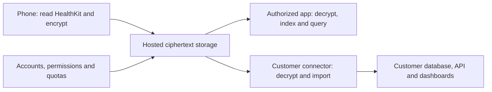

# Proposal: end-to-end encrypted hosted health vault

Status: design exploration for future implementation. No implementation,
launch commitment, protocol change, or production privacy promise is made here.

Related issue: [managed hosting and privacy models #430](https://github.com/PulsHealth/pulshealth/issues/430).
The broader hosting exploration is [draft PR #431](https://github.com/PulsHealth/pulshealth/pull/431).
This proposal stands alone and does not require that branch to be merged.

## Objective and recommended starting point

Host synchronization and storage for individuals and organizations without
placing health-data decryption keys or plaintext on the hosting infrastructure.
Encrypt on the phone; decrypt only on authorized customer endpoints. Keep the
existing readable self-hosted backend as a separate option.

Start with an encrypted object store, encrypted index, native reader, and
customer-operated connector. Reuse one reviewed encryption protocol across
native apps, a browser reader, SDKs, and organization integrations. Do not attempt
server-side SQL analytics over encrypted health records in the first version.

This is a substantial new storage/transport mode, not an encryption setting for
Postgres. The current ingest server parses health records, the viewer queries
Postgres, and the API/MCP serve readable results. See the current
[privacy policy](../privacy-policy.md), [security guide](../../SECURITY.md),
[database guide](../database-guide.md), and [protocol](../protocol/README.md).

## Threat model and privacy boundary

Target: a copy of every hosted database, object, backup, and ordinary operator
credential is insufficient to decrypt health content. Authentication resets
must not restore decryption access without a customer-controlled recovery path.

Encrypt values, health types, measurement timestamps, profiles, source/device
labels, routes, waveforms, aggregate definitions, and the index that describes
these contents. Use opaque object IDs; never use readable type/date filenames.

The service still sees account/billing information, membership, object sizes,
upload/download times, access patterns, and networking metadata. An encrypted
index does not hide which objects a client requests. Padding and traffic shaping
could reduce leakage, at additional cost; they are not in the initial scope.
TLS, tenant authorization, rate limits, and operational security remain required.
Encryption does not guarantee availability or prevent an operator deleting data.

A proposed statement, subject to implementation and independent review:

> Hosting infrastructure does not possess health-data decryption keys.
> Decryption happens on authorized customer devices or customer-controlled systems.

Do not promise unconditional protection against the software publisher. A
malicious client update could exfiltrate keys or plaintext. A hosted web page
has this risk on every code load. Customer-controlled releases, independently
reviewed clients, verifiable builds, and authenticated enrollment improve the
boundary; open source or a signed app alone does not eliminate it.

Previously uploaded plaintext and backups do not become retroactively private
when copied into an encrypted vault. Migration needs explicit treatment of old
copies, retention, and the limits of any new privacy claim.

## Components



- Control service: account authentication, opaque vault membership, billing,
  quotas, device authorization, and synchronization cursors.
- Object storage: immutable encrypted data, index deltas, snapshots, and key
  packages. Postgres holds operational metadata, not health columns.
- Client library: encoding, encryption, verification, incremental indexing,
  local queries, aggregate resolution, and compaction.
- Organization connector: customer-operated reader with customer-controlled
  keys, optionally importing plaintext into the existing database/API stack.

Readable diagnostics, request logs, crash reports, support bundles, and analytics
must not accidentally carry plaintext or keys. Local decrypted caches and
exports need explicit protection and retention policies too.

## Keys, enrollment, and permissions

Account authentication authorizes ciphertext retrieval; it is not decryption.
An OAuth token, API token, or login session must not alone unlock a vault.

Use random data-encryption keys and a reviewed envelope-encryption design.
Authorized recipients receive wrapped key packages. Choose exact algorithms,
key hierarchy, nonce construction, key versions, and canonical authenticated
encoding during security design; the examples below are not a cryptographic spec.
Use established authenticated-encryption implementations, not custom primitives.
Bind ciphertext to its vault, object purpose, format version, and key epoch.
Never reuse an AEAD nonce with a key. Persist ciphertext for retries rather than
regenerating it ambiguously. Distinct writer authentication is necessary: sharing
a symmetric read key must not implicitly let readers impersonate authorized writers.

Default new-client enrollment:

1. Client generates a recipient key pair locally and requests pairing.
2. A trusted phone or organization administrator verifies the intended public
   key through an authenticated QR/verification flow, with expiry and replay protection.
3. Owner approves the requested datasets, historical access, and capabilities.
4. An authorized endpoint wraps appropriate keys for the new recipient.
5. The server relays that package; the recipient unwraps it locally.

The service must not be able to substitute a recipient public key or approve
itself. Encryption of a key package alone does not authenticate its recipient.
First-device setup must establish the vault trust root locally. Organization
onboarding must verify the organization's recipient key and obtain the intended
sharing authorization; participant ownership versus organization ownership is
an explicit product decision.

Do not grant a master vault key for a supposedly steps-only integration. Narrow
access needs separated keys and scoped indexes (or an explicit limited export),
not just an API filter. Mixed-type objects must not cross cryptographic scopes.

Recovery options: another trusted device, a high-entropy offline recovery key,
or an organization-controlled recovery authority. If all are lost, hosted data
cannot be recovered by support. Password-derived unlocking, hardware-backed
keys, and passkey-related key mechanisms require separate design; ordinary
passkey login does not automatically supply a portable decryption key.

Revocation blocks future downloads and requires key rotation for future content.
It cannot erase copied plaintext or previously acquired keys. Define historical
access, device replacement, offline writers, and rotation races before release.

## Object granularity and sizing

Use health type × UTC day as the logical grouping for ordinary raw samples,
with bounded immutable chunks as the physical storage unit. A day may contain
many upload chunks. UTC partitioning does not replace recorded temporal context
or account reporting calendars; clients filter exact intervals and preserve
local-day semantics for aggregates and activity summaries.

Routes, ECG traces, and other large recordings are separate attachment streams,
linked through encrypted manifests. Split oversized attachments independently.
A sample crossing midnight can be assigned by start time, but the encrypted
index must retain interval bounds so overlap queries do not miss it.

Prototype target: about 1 MB compressed per chunk, with separately enforced
uncompressed-size, record-count, attachment-part, and decoder-allocation limits.
This is a tuning starting point, not a measured universal maximum. Compress
before encrypting; account for envelope overhead when enforcing upload limits.
Do not mix attacker-controlled content with secrets in a compression context
without reviewing compression side-channel risks.

Use synthetic benchmarks covering ordinary samples, dense workout streams,
large metadata, and waveforms. Measure serialized NDJSON and compressed bytes,
peak phone memory, battery cost, latency, request count, and cold-start indexing.
Database disk size is not an upload-size estimate. Exact personal dataset
measurements and identifiers must remain outside the public repository.

## Incremental raw-data sync

A day is not one mutable encrypted file. New data appends new objects:

```text
Logical group: active energy / day D
  opaque object A: first upload
  opaque object B: later samples
  opaque object C: later samples and/or separate mutation records
```

Normal operation never needs to download and re-encrypt previous raw objects.

1. Read a HealthKit page using the existing destination-scoped anchor.
2. Encode canonical records, compress, encrypt, and persist a retryable operation.
3. Upload staged objects under random immutable IDs.
4. Publish an encrypted index delta referencing the durable objects, using a
   stable operation ID and a transactional metadata commit.
5. Only after publication acknowledgment, persist the corresponding anchor.

Object storage and Postgres do not share a transaction. Upload objects first,
verify durability/existence, then transactionally publish references and the
commit record. An interrupted upload leaves unreferenced objects for delayed
cleanup; it must never expose a manifest pointing at missing data. Retried
publication returns the original result. Ciphertext authentication and semantic
validation occur on trusted clients, not on the blind storage service.

Preserve anchor-after-ack even if a page exceeds a physical chunk limit: multiple
objects can belong to one logical page commit. Do not partially acknowledge a
HealthKit page or silently split existing batch semantics. A new transport mode
requires an explicit versioned contract and compatibility tests.

Deduplicate raw samples using encrypted identities when materializing locally.
Deletions are encrypted tombstones, not merely omitted index entries. Clients
must apply them to caches, snapshots, and subsequent compactions. Define delete
ordering and resurrection prevention, including offline/replayed uploads.

Preserve recent-first sync, canonical units, epoch milliseconds, unreadable or
locked HealthKit behavior, limited-history protection, and independent export
state. Never interpret an unreadable HealthKit range as a deletion request.

## Encrypted index: snapshots plus changes

A client-local index maps type/time predicates to opaque object IDs. Its hosted
representation is encrypted. A conceptual decrypted delta might contain:

```text
operation: add
object: opaque-object-id
type: active-energy
time-range: [startEpochMs, endEpochMs)
record-count: 120
writer-revision: ...
```

Only the encrypted envelope, transport cursor, and operational metadata are
visible to the service. Each upload publishes a small delta; the writer does
not download and rewrite the complete index.

Readers retain their last verified position, fetch encrypted deltas after that
cursor, decrypt/verify them, and update their local index. A query for a week's
active energy selects IDs locally, downloads only missing chunks, decrypts them,
and filters exact timestamps. API-shaped health queries are SDK/local-connector
operations; the hosted API serves opaque objects and encrypted log entries.

Periodically, an authorized client publishes an encrypted snapshot covering a
precise committed prefix of the log, then readers apply the suffix. Snapshot
publication uses a generation check and cannot discard concurrent appends.
Partition large snapshots by month or access scope with an encrypted directory;
new devices fetch a bootstrap manifest and the necessary partitions/deltas.

Server sequence numbers are transport cursors, not proof of integrity or
freshness. Design authenticated writer histories, checkpoints, replay detection,
and cross-device consistency checks. A malicious server can withhold updates;
new-device rollback/fork detection needs a trusted checkpoint or independently
witnessed state. Do not claim that AEAD or a hash chain alone solves this.

## Aggregates and mutable records

An aggregate bucket is one logical record, not necessarily one storage object.
Its identity includes type, function, interval, filters, calendar semantics, and
bucket start. Revisions replace the value; they are never added together.

```text
Daily steps, same bucket:
  revision 1: 1,000
  revision 2: 4,000
  revision 3: 7,000
Resolved value: 7,000, not 12,000 (synthetic example)
```

Batch revised buckets into encrypted upload objects, within the same access
scope. A monthly snapshot of a daily series contains roughly one value per day,
plus subsequent deltas. This avoids one network object per scalar value.
Empty/null updates explicitly clear stale values; late arrivals and deletions
can revise past buckets. Keep aggregate calculation on an authorized phone or
customer-controlled engine. Raw step summation is not automatically equivalent
to HealthKit statistics when sources overlap; preserve the existing semantics.

Initial simplification: designate one authoritative writer per aggregate series.
Multi-writer revisions require explicit conflict resolution; server arrival
order or device wall clocks alone must not let a stale offline calculation win.
Changing writer authority requires a verified generation transition. Activity
summaries and mutable profile snapshots need similarly explicit replacement rules.

## Compaction, retention, and deletion

Authorized clients may merge small raw chunks into larger daily chunks and
aggregate deltas into monthly snapshots. Compaction decrypts and re-encrypts
occasionally, not at every sync. It can use locally cached plaintext where safe.

Publish replacements atomically in metadata with the exact input generation.
Keep old objects until reader leases/grace periods and retention policy permit
collection; stale readers must be able to bootstrap from a current snapshot.
A blind server cannot infer all encrypted references, so define a minimal opaque
reference/retirement manifest or client-authorized retirement protocol. Such a
manifest leaks relationships and must be included in the metadata threat model.

Separate compaction from user erasure. Erasure includes live objects, index
history, caches, key packages, backup expiry, and restore procedures that do not
resurrect deleted material. Offline recipients and previously exported copies
cannot be remotely guaranteed erased. Key destruction is not sufficient when
recipients retain old keys and ciphertext.

## Client access and deployment choices

| Client | Enrollment and key custody | Query/decryption location | Main limitation |
|---|---|---|---|
| Native phone app | Trusted-device approval; OS-protected keys | App | Device compromise and publisher updates |
| Desktop app | Pairing QR; OS key store | Desktop | Local caches and update trust |
| Hosted browser dashboard | Phone-approved session or remembered browser | Browser | Operator-delivered JavaScript can read plaintext |
| Customer-hosted frontend | Customer-approved releases and browser enrollment | Browser | Still trusts served scripts and browser environment |
| CLI / SDK | Pairing command; OS store or protected credentials | Machine executing the program | Deployment location determines plaintext access |
| Local API bridge | Installed paired daemon | Local process serving authenticated queries | Origin/auth checks; receiving webpage still sees results |
| Organization connector | Verified organization enrollment; customer key service | Customer infrastructure | Customer operators become authorized readers |
| Third-party cloud integration | Explicit scoped grant to provider | Third-party infrastructure | Provider receives plaintext within its grant |
| Offline export | Encrypted package with separately authorized key delivery | Recipient device | No reliable revocation of copied data |

Browser options: session-only keys in memory or persistent enrollment with
protected local credentials. Locking a session does not erase downloaded files.
Non-extractable browser keys do not prevent malicious scripts from invoking
permitted decryption or capturing displayed results. A local bridge protects
key custody but does not hide plaintext returned to an operator-controlled page.

An organization connector can import into a customer-controlled Postgres /
TimescaleDB and expose the existing product API, dashboard, and MCP patterns.
No phone must remain online once the connector has its approved keys. Enforcing
customer ownership requires that the hosting operator cannot administer the
connector host or its key-release policy.

AI follows the same boundary: local MCP decryption does not make a cloud model
local. Sending readable tool results to an AI provider shares those results
with that provider. Existing hosted OAuth/MCP access does not automatically
translate into a decryption grant.

## Alternatives and deferred work

- Readable type/date indexes simplify hosted filtering but disclose health
  metadata. They are an explicit weaker privacy mode, not the default here.
- Organization-owned deployments can retain normal SQL if the organization
  controls plaintext compute and keys, with no hosting-operator access.
- Confidential computing may permit hosted computation with attested key
  release. It needs customer-controlled approval of code measurements, key
  policy, upgrades, and outputs; ordinary operator-managed KMS encryption is
  not equivalent. Evaluate separately after the simpler endpoint model.
- Searchable encryption, homomorphic analytics, and private access-pattern
  schemes are not prerequisites for the initial product and are out of scope.
- Regulatory obligations, consent, retention, and contracts require separate
  assessment; encryption alone does not establish an exemption or compliance.

## Implementation sequence and acceptance gates

1. Agree threat model, metadata leakage, ownership, recovery, access scopes,
   and browser/update trust. Specify protocol and key lifecycle with security review.
2. Build a synthetic vertical slice: phone encryption, durable object+delta
   commit, approved reader enrollment, local query, and retry-safe acknowledgment.
3. Add snapshot bootstrapping, aggregate revisions, deletion, rotation, and
   compaction. Benchmark cold and incremental reads, background sync, and memory.
4. Add SDK/CLI and customer connector; adapt browser UX only with an explicit
   trust statement. Preserve the readable self-hosted destination independently.
5. Commission independent cryptographic/protocol review, complete recovery and
   operational drills, then update privacy/security/product documentation before
   considering real customer data or launch.

Required acceptance evidence:

- Server/database/backup dumps plus operator credentials cannot decrypt content.
- Tampered ciphertext, cross-vault substitution, unauthorized writer entries,
  and pairing-key substitution are rejected.
- Crashes at every upload/publish/ack boundary cause neither missing records nor
  unsafe anchor advancement; retries converge without duplicate logical events.
- Concurrent writers and snapshot publication preserve every committed update.
- Aggregates do not double-count revisions; stale writers cannot replace newer
  authority; null updates and HealthKit permission limits behave correctly.
- Replayed deleted samples do not reappear after compaction or restore.
- Recovery, new device setup, key rotation, revoked/offline devices, and scoped
  grants are exercised, including negative tests for unauthorized datasets.
- Decompression limits, malformed objects, lost indexes, large attachments, and
  interrupted compaction are bounded and recoverable.
- No secrets or health content appear in hosted logs, telemetry, or support dumps.
- Browser and publisher trust limits are documented rather than claimed solved.

Open decisions before coding: exact crypto suite and format; scope/key hierarchy;
checkpoint trust and fork detection; aggregate writer handoff; compressed and
uncompressed limits; compaction ownership; offline retention/GC policy; local
cache protection; organization consent and recovery; migration of existing
plaintext data; and versioning/integration with Puls Sync Protocol v1.

## References

- [Web Crypto security considerations](https://www.w3.org/TR/webcrypto-1/#security-considerations)
- [Apple Keychain services](https://developer.apple.com/documentation/security/keychain-services)
- [Authenticated encrypted streams](https://libsodium.gitbook.io/doc/secret-key_cryptography/secretstream)
- [Apple encrypted-data recovery tradeoffs](https://support.apple.com/en-gb/108756)
- [AWS attested KMS calls](https://docs.aws.amazon.com/kms/latest/developerguide/attested-calls.html)

References explain building blocks and limitations; none constitutes a reviewed
PulsHealth encryption protocol or implementation guarantee.
