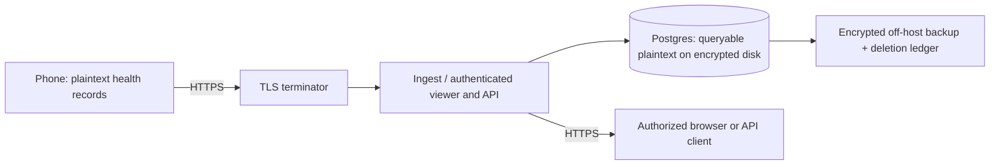
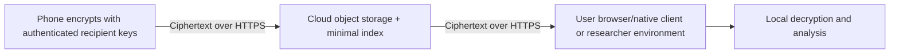

# Privacy and encryption options

Exploration dated 2026-10-30. [Overview](README.md).
These are proposed guarantees and constraints, not current product claims.

## Answer the privacy question precisely

We can offer encrypted hosting. Whether we can truthfully say **we cannot read
your data** depends on who can obtain keys and who controls the code that sees
plaintext. Encryption, tenant isolation, and availability are separate properties.
No design guarantees protection against every attack or loss.

| Design | Where plaintext exists / who can read | Dashboard and API | Cost and work | Defensible claim after verification |
|---|---|---|---|---|
| TLS + encrypted disks/backups | Phone, browser, TLS termination, application and database; privileged operator can read | Existing server queries work | Low incremental infrastructure cost; operations still required | Encrypted in transit and at rest; access restricted |
| Separate database/VM/account per customer or institution | Same plaintext paths, but fewer tenants share credentials and failure domains | Existing queries largely reusable | Increasing fixed cost and deployment overhead | Dedicated environment; operator remains trusted |
| Application encryption with service-held per-tenant keys | Sensitive fields decrypt in the application; authorized service/operator can read | Encrypted fields lose ordinary indexes, SQL filters, rollups and compression unless decrypted elsewhere | Material redesign; key lifecycle and leakage analysis | Extra protection against database-only compromise |
| Customer-controlled KMS key, service permitted to decrypt | Service sees plaintext while permitted; customer controls key permissions | Conventional queries possible when service can decrypt | Enterprise setup and recovery complexity | Customer-controlled key access, not operator-blind hosting |
| End-to-end encrypted vault | Only authorized user/researcher endpoints hold decryption keys; storage has ciphertext | Client-side dashboard and encrypted API + SDK; no ordinary server-side plaintext query API | High engineering effort; storage itself can be inexpensive | Server cannot decrypt stored content under the stated key/client model |
| Attested confidential processing | Plaintext in an approved enclave and authorized endpoints | Selected processing possible after redesign | High specialization and operational cost | Plaintext processing restricted to verified code under stated hardware/key-policy assumptions |

AWS EBS encryption covers volumes and their encrypted snapshots; it is transparent
to the running operating system. It does not turn PostgreSQL into an encrypted
query engine. Encrypt every separate copy too: dumps, temporary files, WAL,
exports, replicas, logs containing sensitive values, and recovery-test storage.
See [AWS EBS encryption](https://docs.aws.amazon.com/ebs/latest/userguide/ebs-encryption.html).

## A. Practical managed-hosting privacy

The diagram's trusted plaintext boundary includes the TLS terminator, application,
database and host administrators. Cross-host internal connections also need TLS.
The existing policy identifies Cloudflare as a TLS terminator: keeping that path
keeps Cloudflare in the trusted processing chain. Direct TLS termination on our
AWS host removes that particular intermediary but changes ingress protection and
operations. Inventory the actual route before making a claim.

Proposed controls: private DB ports; accounts mode; individual write tokens;
token-derived read identity; scoped database roles; no public static operator
tokens; MFA for administration; short-lived, logged support access; no health
payloads in telemetry; encrypted off-host recovery with tested deletion replay.
Customer-approved support access is a policy safeguard, not cryptographic
inability to access data. A sole operator can enforce approval workflows but
cannot honestly claim independent two-person control without another approver.

Possible wording **only after implementation and verification**:

> Your connection, stored records and backups are encrypted. Your account is
> isolated from other customers. Our servers process readable records to provide
> sync, dashboards and API responses. Authorized administrative access is
> restricted and logged. This service is not end-to-end encrypted.

This is the best fit for the first $5 service if users accept that trust model.

## B. What customer-held keys do and do not buy

Distinguish an AWS **customer-managed key** owned by PulsHealth from a key
controlled by the paying customer in their own account. The first is still ours.
Envelope encryption uses data keys wrapped by a key-encryption key; per-tenant
data keys can limit some compromise scenarios without one paid KMS key per user.
Neither stops an application that is authorized to unwrap those keys.

An institution can grant a service access to its own KMS key and revoke it later.
That provides control over future decryption. It cannot retract plaintext already
exported or cached. For volume encryption, disabling a KMS key is not a reliable
instant shutdown of a mounted database. Define and test revocation behavior for
the chosen mechanism, including key caches, running processes and backups.

Encrypted columns are also not a drop-in replacement for disk encryption:
server-side decryption still exposes values to the service, while keeping fields
encrypted during queries breaks ordinary health aggregations. Deterministic or
searchable indexes reveal patterns and need a separate leakage assessment.
Do not market them as equivalent to a user-only key vault.

## C. An end-to-end encrypted vault

Design direction: encrypt bounded batches on the phone using a reviewed
authenticated-encryption library and unique nonces; bind account, object,
schema version and sequence context to the authenticated payload. Wrap data keys
to authorized devices or an institution key. Compress before encryption. The
server stores opaque objects and minimal routing metadata; clients build local
indexes and charts after decryption. These are design requirements, not a
finished cryptographic specification.

The current gzip NDJSON protocol, server parser, SQL summaries, viewer and MCP
expect plaintext. Introduce a separately versioned encrypted transport/receiver;
preserve anchor-after-ack with durable ciphertext storage, retry idempotency,
sample deletions, ordering, integrity and rollback detection. An opaque receiver
can acknowledge storage but cannot validate the health semantics inside it.

Consequences to resolve before promising this:

- **Browser access remains possible.** It downloads and decrypts data locally;
  large histories need chunking, local indexes and bounded memory. The present
  server-rendered dashboard is not reusable unchanged.
- **API remains possible.** It returns ciphertext, with a client SDK for
  decryption. A conventional plaintext API or remote AI/MCP service must be an
  authorized recipient or run in the customer's environment. Explicitly granting
  a cloud service keys or plaintext expands the privacy boundary.
- **Recovery is a product decision.** New-device approval, key backup, device
  revocation, rotation and lost-phone recovery need a complete UX. If every key
  is lost, we cannot recover the content. A login password reset must not silently
  become a decryption backdoor. Escrow changes who can read.
- **Metadata remains.** Account/billing identity, IP addresses, sizes and upload
  times can be visible. Encrypt health-type labels and profiles too, and document
  any intentional plaintext indexing. Ciphertext is not anonymous data.
- **Client delivery matters.** A compromised server could serve malicious web
  JavaScript that steals keys. Strong protection from a malicious operator needs
  independently controlled or verifiable client delivery, authenticated recipient
  keys, and reviewed updates; even native signing alone does not prevent an
  authorized publisher from shipping a malicious update.
- **Sharing is irreversible once read.** Revocation can block future delivery
  and new keys, not erase a researcher's exports. Encrypting historical server
  records later cannot prove earlier plaintext copies never existed.

For research, the most tractable variant is participant-to-institution encryption:
the institution holds keys and runs analysis; PulsHealth handles collection,
ciphertext storage and delivery. Participants must know that the institution can
read what they share, even if PulsHealth cannot.

## D. Confidential computing and other advanced options

AWS Nitro Enclaves isolates processing from the parent host and supports
attestation-bound KMS access. Enclaves lack normal persistent disks and external
network interfaces; this is not a checkbox on the existing Compose database.
See [Nitro Enclaves](https://docs.aws.amazon.com/enclaves/latest/user/nitro-enclave.html)
and [attested KMS calls](https://docs.aws.amazon.com/kms/latest/developerguide/attested-calls.html).

A credible design must encrypt from the client to the attested workload, keep
persistent storage encrypted outside it, authenticate query users inside it,
encrypt results to authorized recipients, and prevent the operator from simply
changing the allowed image or key policy. Independent customer control of release
approval/key policy matters. This can preserve selected server computations with
less operator trust, but adds hardware, supply-chain, rollback and code-review
assumptions. Defer it until a funded customer requires it.

Fully homomorphic encryption or multiparty computation may support narrowly
defined analyses, but are not proposed substitutes for the full SQL/dashboard
workload. Separately, on-device aggregation reduces what is collected, and
differential privacy can protect suitable cohort releases. Neither is encryption
of an identifiable raw health record or an automatic anonymity guarantee.

## Verify each promise

| Promise | Required evidence |
|---|---|
| Encrypted in transit/at rest | Trace every hop and copy; inspect storage/key configuration; inspect sanitized logs and exports |
| Customers isolated | Negative tests across two accounts for every read/write/export/delete path, tokens, caches and concurrent pooled requests |
| Restricted operator access | Role inventory, MFA, access logs, support approvals, credential rotation and tested incident procedures |
| Recoverable and deletable | Restore off-host backup into isolation, replay current deletion ledger, verify expiry of every copy; measure recovery time |
| Operator cannot decrypt content | Independent cryptographic/client review, authenticated key distribution, no server-held recovery key, and loss/recovery/sharing tests |

Test evidence establishes a bounded guarantee, not immunity from all breaches.
