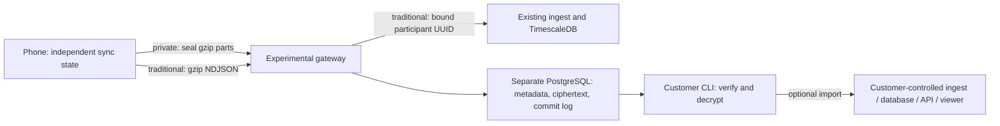

# Experimental private hosting and programs

**Experimental branch; synthetic data only. Not a production privacy guarantee.**
Tracks [#443](https://github.com/PulsHealth/pulshealth/issues/443), based on the
[encrypted-vault proposal](https://github.com/PulsHealth/pulshealth/pull/442)
and [hosting options](https://github.com/PulsHealth/pulshealth/pull/431).
Nothing here deploys or migrates an existing installation.

This is a runnable vertical slice, including a separate PostgreSQL control/
ciphertext service, customer CLI/connector and Debug-only iPhone enrollment and
collection. The ordinary database and account implementation are unchanged.

## Product and ownership

| Choice | Content custody | Reading/querying |
| --- | --- | --- |
| Individual + traditional | Existing ingest/database operators | Existing database/API/viewer |
| Program + traditional | Existing ingest/database operators and program | Participant UUIDs in existing database; customer controls access |
| Individual + private | Individual holds the recipient private key | Customer CLI, optionally customer-operated database connector |
| Program + private | Program holds the recipient private key | Program-operated CLI/connector and its own database/API/viewer |

An individual workspace permits one enrollment. A program permits multiple
participants. Participants can also keep their ordinary personal database:
program collection has an independent engine, Keychain enrollment and anchors.
This app prototype permits one additional experimental enrollment at a time.

A program creates a fixed collection policy: name, hosting mode, allowed raw
HealthKit types, earliest date, consent text/version and recipient public key.
The policy and mode cannot be edited after creation. A new policy/key requires
a new program and new participant review. The program owns collected copies;
leaving revokes future writes but does not delete already collected records.
The consent text must explain the operator, purpose, retention, withdrawal and
contact route. This implementation does not supply institutional verification,
ethics approval or a complete research consent system.

A program manager makes a single-use 24-hour invitation for each participant.
An invitation can be delivered as a code, a `puls://program` link, or its QR.
The app reviews the destination, data types, start date, hosting boundary and
consent before joining. For private mode, compare the recipient fingerprint
through a trusted program channel; a QR/link supplied by the program carries
the expected public key. An unverified code alone cannot authorize a key.
The server's response is never the source of the expected fingerprint.

Joining does not read HealthKit. **Start Collection** separately requests Health
access, begins the initial sync and enables subsequent HealthKit observer and
foreground collection. Pause persists locally and closes the upload gate.
Leave pauses first, then revokes the enrollment remotely. If offline, retry the
remote revocation; do not confuse local pause with a server acknowledgment.
An already in-flight upload may finish. The experiment does not register an
additional BGProcessing catch-up schedule; device/background acceptance remains
outstanding. It respects the app's existing subscription access policy.

The first app slice collects raw samples and their deletion events. Profile
fields, routes, enhanced workout streams, aggregates and activity rings are
excluded. Sample metadata/source labels and basic workout statistics can still
be present. Unknown/unavailable types are refused before enrollment. The
sealed transport itself accepts complete protocol-v1 pages, including aggregate
revisions, for subsequent expansion without changing its envelope format.

## Storage and protocol



Read-only inspection of the live database informed these decisions. Exact
measurements and connection details remain outside the public tree.

- Ordinary compressed pages were small, but historical uploads included much
  larger outliers. Route storage was comparable to quantity storage. Therefore
  physical objects are **at most 1 MiB of compressed content**, while one logical
  page may publish up to 256 objects. No page is partially acknowledged.
- The present client serializes/compresses the full page in memory, with a
  256 MiB plaintext ceiling. Splitting bounds each HTTP object, **not peak phone
  memory**. Oversize pages fail without advancing anchors; streaming encoding
  and attachment-specific paging are still needed before broader use.
- Real deletion traffic and aggregate updates rule out append-and-sum readers.
  The connector feeds the original decrypted NDJSON into the existing ingest,
  which already deduplicates sample UUIDs, processes tombstones and replaces
  aggregate buckets. It preserves source calendars and epoch milliseconds.
- Many small pages make rewriting a full encrypted index on every update
  unattractive. Each participant gets a paged append log with an opaque cursor.
  An authorized connector incrementally materializes it locally. There is no
  hosted SQL/query endpoint over private content in this slice.

`PUT /v1/participants/{id}/objects/{object}` stores an immutable encrypted part.
An identical retry succeeds; different bytes under the same ID return 409.
`POST /v1/participants/{id}/commits` supplies a random commit ID and ordered
object IDs. A transaction verifies that every part exists, serializes that
participant's cursor and publishes the entire commit. Retrying the same ID/list
returns the original cursor. Missing parts or changed lists return 409.
Readers cannot download unpublished objects. Only after checking the publication
receipt does the phone's transport return success, allowing anchor persistence.

The phone stages ciphertext and a manifest in a protected, backup-excluded
outbox before the first request. It reuses ciphertext on retry, including a
replayed identical page after restart. A crash after acknowledgment but before
anchor persistence can still publish duplicate logical samples; the customer
materializer deduplicates by original identities. Commit cursors are transport
positions, not authenticated freshness or rollback proofs.

Cipher suite v1: fresh ephemeral X25519 agreement per part; HKDF-SHA256 with
UTF-8 salt `puls-vault-v1`, authenticated context as HKDF info, 32-byte AES key;
AES-256-GCM with a fresh random 12-byte nonce and 16-byte tag.
Context is UTF-8 `puls-vault-v1\n{lowercase participant UUID}\n{lowercase commit UUID}\n{zero-based part}`.
Binary object: `ephemeral public key[32] || nonce[12] || ciphertext || tag[16]`.
The encrypted content is a slice of one gzip protocol-v1 NDJSON page. Reassemble
ordered authenticated parts, then decompress with the 256 MiB output limit.
This is an experimental protocol, not a reviewed cryptographic standard.

PostgreSQL stores encrypted `bytea` objects and metadata in the **separate
experiment database**. This deliberately provides one durable transaction
boundary. It is not a claim that PostgreSQL is the final cheapest object store.
The service has a 2 GiB stored-object quota per participant (including staged
objects). There is currently no automatic orphan GC, compaction, retention
expiry or erasure workflow. Unpublished objects count against that quota.
For scale, move blobs to object storage with verified durable upload first,
transactional publication second, and grace-period orphan collection. Do not
acknowledge a page before both durability and publication.

## Trust and limitations

Hosting stores no recipient private keys. Authentication/password reset cannot
recover the private health content. Individual users keep their private key;
programs keep theirs on customer-controlled systems, separately from the
PulsHealth gateway. Losing all copies loses access. Protect the key file and
make an offline recovery copy before use. There is no device-key wrapping,
key rotation, per-researcher read grant or trusted-device recovery UI yet.
The first slice deliberately avoids treating shared program keys as scoped
steps-only grants: the recipient can decrypt every object in its workspace.

Operator credentials/database/backups do not provide the X25519 private key.
Nevertheless, the host sees program/consent policy (including selected types and
start date), membership, sizes, part relationships, upload/access times and
network metadata. Measurement values/timestamps, sample metadata and identities
inside a private page are encrypted. Provisioning, invitation and manager API
payloads are metadata and must not contain health records.

A host can delete/withhold/replay content and can forge new encrypted content
using the public recipient key. AEAD checks context and tampering, but this
slice has no independently authenticated writer history or rollback/fork
witness. Do not treat decrypted records as authenticated research evidence.
A malicious app update can steal plaintext or keys; a hosted browser that
receives keys would add that trust on every page load. This experiment does not
add browser decryption or send private results to hosted AI/MCP. The connector
must run outside hosting-operator administration. Original plaintext uploads
and backups remain plaintext copies; this is not an in-place migration.

Manager authorization grants workspace-wide ciphertext access. Participant
credentials grant uploads/leave only for that participant. Provisioning is an
operator token, separate from each returned manager token. Tokens are hashed
in storage; enrollment tokens are generated and saved by the app before a
single-use invitation is consumed, allowing safe retries. Revocation/closure
serialize with publication. Traditional ingest gets only the server-configured
upstream token and the authenticated participant UUID, never caller-selected
identity/destination headers. Its raw type/date scope is checked before forwarding.
Use a separate traditional backend per customer where a shared reader role
would otherwise reveal another program. There is no organization RBAC in the
existing hosted viewer yet; a manager token is not a viewer account or MCP grant.

## Run locally

Requires Docker Compose, Go 1.26.6+, and Xcode for the app. This directory is a
standalone Go module; commands below run here. Configure an untracked env file
with URL-safe randomly generated secrets (do not put it in Git):

```sh
export EXPERIMENT_DB_PASSWORD=YOUR_RANDOM_DISPOSABLE_PASSWORD
export EXPERIMENT_APP_PASSWORD=YOUR_SEPARATE_RANDOM_PASSWORD
export EXPERIMENT_PROVISION_TOKEN=YOUR_32_BYTE_OR_LONGER_RANDOM_TOKEN
docker compose -p puls-vault-experiment -f compose.yml up --build -d
```

The dedicated `migrate` service applies `schema.sql` only to this disposable
database. The gateway uses the limited `experiment_app` role, not its admin.
The prototype schema bootstrap is idempotent; freeze it into numbered immutable
migrations before running upgrades against retained data. Default port is
loopback-only 8099; phones require a deliberately configured HTTPS test proxy.
Never point this service/migrator at the production database. No Cloudflare,
AWS or production changes are made by this branch.

For traditional mode, explicitly set `EXPERIMENT_INGEST_URL` and
`EXPERIMENT_INGEST_TOKEN` to a **scratch** reference ingest backend. Its token
must permit the new participant users (for example a dedicated shared ingest
token). Private mode needs neither of those variables.

```sh
go build -o /tmp/vaultctl ./cmd/vaultctl
/tmp/vaultctl keygen /PRIVATE/DIRECTORY/program.key
```

This creates a new file with mode 0600 and refuses overwrite, then prints the
**public** recipient key/fingerprint. Create a local `program.json`:

```json
{
  "name": "Synthetic walking program",
  "kind": "program",
  "mode": "private",
  "recipientKey": "PUBLIC_BASE64_KEY_FROM_KEYGEN",
  "types": ["HKQuantityTypeIdentifierStepCount"],
  "startMs": 0,
  "consent": "Synthetic development collection only. Explain purpose, recipient, withdrawal and retention here before testing.",
  "consentVersion": "synthetic-v1"
}
```

Choose `kind: individual` for a single-person workspace. For traditional mode
use `mode: traditional` and an empty recipient key. This is immutable after creation.

```sh
export VAULT_URL=http://127.0.0.1:8099
export VAULT_TOKEN="$EXPERIMENT_PROVISION_TOKEN"
/tmp/vaultctl create /PRIVATE/DIRECTORY/program.json
# Save the returned ID and managerToken privately, then use the manager token:
export VAULT_TOKEN=YOUR_RETURNED_MANAGER_TOKEN
/tmp/vaultctl invite YOUR_PROGRAM_UUID /PRIVATE/DIRECTORY/program.key
/tmp/vaultctl participants YOUR_PROGRAM_UUID
```

`invite` derives the public-key pin from the customer-held private key file and refuses a gateway key mismatch. For a traditional program, pass `--traditional` instead of the key file. It prints a single-use code and join URL with the independently chosen mode, program ID and key pin.
Deliver that URL or its QR through the intended program's trusted channel;
never publish/log invitations or save them in the repository. The app can scan
an externally rendered QR or open the link directly. In a **Debug build**,
Settings → Experiments → Private Hosting & Programs also accepts the server,
code and expected fingerprint manually. Review, join, then start collection.
No public program directory is exposed, preventing accidental disclosure of
sensitive program participation.

On the customer's machine, with the manager token and private key:

```sh
# Emits verified plaintext pages to stdout. Store output privately.
/tmp/vaultctl read YOUR_PARTICIPANT_UUID /PRIVATE/DIRECTORY/program.key
# Import into the customer's own reference backend, with a durable bound cursor:
export CONNECTOR_INGEST_URL=https://YOUR_CUSTOMER_INGEST
export CONNECTOR_INGEST_TOKEN=YOUR_CUSTOMER_INGEST_TOKEN
/tmp/vaultctl import YOUR_PARTICIPANT_UUID /PRIVATE/DIRECTORY/program.key /PRIVATE/DIRECTORY/cursor.json
# Stop a participant remotely, or close enrollment and all uploads:
/tmp/vaultctl revoke YOUR_PARTICIPANT_UUID
/tmp/vaultctl close YOUR_PROGRAM_UUID
```

Import binds the cursor to the source, participant, recipient key and normalized customer destination URL; changing the destination requires a fresh cursor and full replay. It advances only after acknowledgment from customer ingest.
Repeat the command to catch up; it is a bounded catch-up command, not a daemon.
Keep customer database credentials/keys out of the hosting environment. The
customer controls plaintext retention, backups and API/viewer access there.

## Validation and release gates

```sh
go mod verify && go vet ./... && go test -race -count=1 ./...
# With schema.sql applied to a separate scratch PostgreSQL, as experiment_app:
EXPERIMENT_TEST_DATABASE_URL=YOUR_SCRATCH_DATABASE_URL go test -race -count=1 ./...
# Actual shared native crypto implementation, executable on macOS without a simulator:
swiftc ../../PulsHealthSync/Sources/PulsHealthSync/Experimental/VaultCipher.swift tests/CipherAcceptance.swift -o /tmp/vault-cipher-test
/tmp/vault-cipher-test testdata/cipher.json /tmp/vault-swift-envelope.bin
VAULT_SWIFT_ENVELOPE=/tmp/vault-swift-envelope.bin go test -run TestSwiftCipherAcceptance
```

Integration tests exercise one-use enrollment/retry/expiry, individual-workspace limits, atomic publication/missing
parts, immutable-object conflicts, concurrent cursors, gateway recreation,
manager/participant isolation, revocation/closure, traditional identity binding,
customer import acknowledgment and bound cursors. All use synthetic records.
The checked-in crypto private key is a deliberately public synthetic fixture.

Before real data or launch: independent crypto/protocol review, authenticated
writer enrollment/history, trusted checkpoints, scoped recipient keys and
rotation, customer-owned recovery and drills, erasure/backup retention, GC,
streaming large-page/attachment benchmarks, scoped program-reader authorization,
complete consent/retention lifecycle, rate/abuse limits and total workspace
quotas, production-grade schema migrations, and signed physical-device/background
acceptance. No existing production claim should be changed to “operator blind”
based on this experimental branch.
